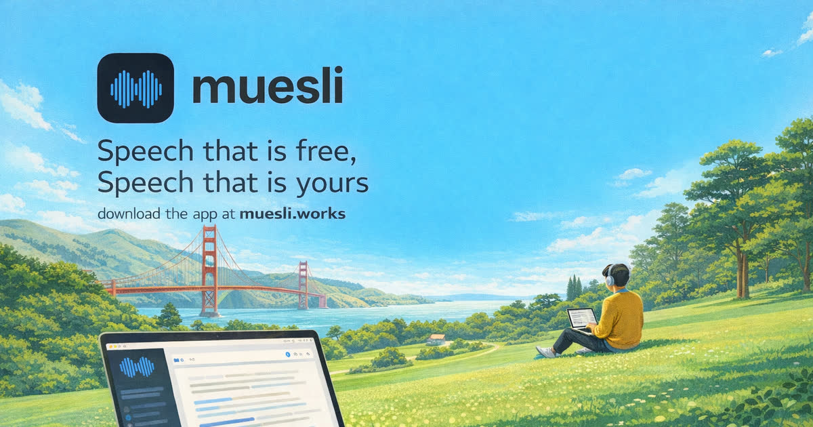
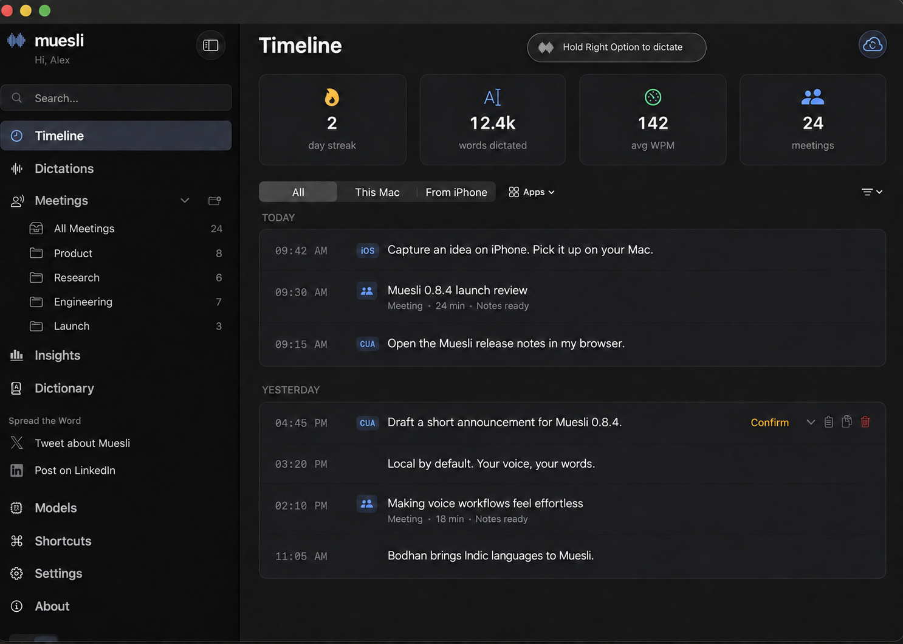
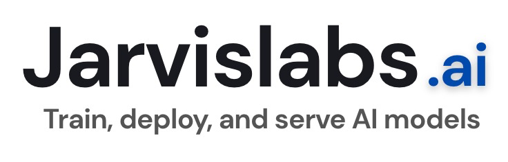

<p align="center">
  
</p>

<h1 align="center">Muesli</h1>

<p align="center">
<a href="https://trendshift.io/repositories/25442?utm_source=repository-badge&amp;utm_medium=badge&amp;utm_campaign=badge-repository-25442" target="_blank" rel="noopener noreferrer"></a>
</p>

<p align="center">
  <strong>Local-by-default dictation & meeting transcription for macOS</strong><br>
  On-device speech-to-text by default · Optional OpenAI or OpenRouter dictation · Privacy by default
</p>

<p align="center">
  <a href="LICENSE"></a>
  <a href="https://buymeacoffee.com/phequals7"></a>
  
  
</p>

<p align="center">
  <a href="https://chatgpt.com/plugins/plugins_6abe2bb24af081919ea718e221cfdafa">Get the Muesli plugin for ChatGPT and Codex</a> · <a href="https://muesli.works/blog/muesli-chatgpt-codex-plugin/">Setup guide</a>
</p>

---

## What is Muesli?

Muesli is a **native macOS app for dictation and meeting transcription**, built for Apple Silicon. Speak into any text field, capture a meeting without a bot, and turn transcripts into notes or a plan for your next task.

Speech recognition runs on your Mac by default. Hosted transcription and AI features are optional and send the content needed for the selected task to your provider. iCloud sync transfers text and sync metadata, never audio. See [Muesli's privacy policy](https://muesli.works/privacy).

<p align="center">
  
</p>

<p align="center"><sub>Illustrative entries and usage statistics. Personal content has been replaced.</sub></p>

## Features

- **Dictation anywhere** — Hold a hotkey, double-tap for hands-free recording, or use Press to toggle. Text is pasted at your cursor, with optional filler removal and cleanup.
- **Custom vocabulary and dictionary** — Add names, technical terms, phrase matches, and replacement pairs to improve recognition. Import and export your dictionary as JSON for reuse in the app and CLI.
- **Quill voice writing** — Rewrite selected text, create text at the cursor, or ask a question using a local or hosted model.
- **Cotypist typeahead (experimental, development builds)** — Suggests your next words inline as you type in any app, through a Muesli input source. Tab accepts; ⌥→ accepts one word. Runs entirely on your Mac.
- **Meeting transcription** — Capture microphone and system audio with speaker labels. Enable live captions, import MP3/MP4/M4A/WAV files, or re-transcribe saved meetings with retained audio.
- **Meeting video recording** — Record a selected window or display with meeting audio and play it back locally. Requires macOS Screen Recording and Microphone permissions; obtain permission from meeting participants before recording. See [meeting screen recording](docs/meeting-screen-recording.md).
- **Meeting notes** — Use templates, re-summarize with another model, and export notes, transcripts, and answers as Markdown or PDF.
- **Ask Meetings** — Chat with your meeting notes and transcripts directly beneath a saved meeting or from the Ask Meetings workspace. Use `@` to attach saved meetings, continue with follow-up questions, and open cited passages to check the sources.
- **Your choice of AI** — Generate summaries with OpenAI or Anthropic API keys, OpenRouter, ChatGPT sign-in, Claude Code, Ollama, LM Studio, or a custom endpoint. Hosted providers receive the transcript for the requested task.
- **Multilingual speech** — Choose among Parakeet, Nemotron, Whisper, Qwen3 ASR, SenseVoice, Cohere, Bodhan, and Apple Speech. Bodhan Flex offers Native, Mixed, and Romanized output for Indic languages and English.
- **Calendar and meeting detection** — Show upcoming events from macOS Calendar accounts, choose calendars and time windows, and join or record from reminders. Optional camera and microphone activity detection recognizes meeting apps.
- **Shortcuts and Siri** — Start or stop dictation and meetings, retrieve the last dictation or meeting notes, and connect these actions to your own automations.
- **Voice commands** — Use the optional Computer Use planner for app and browser actions or supported Muesli settings. Choose on-device Gemma on macOS 15+ or a connected ChatGPT account. AI prompt settings remain manual-only.
- **Text sync with iPhone** — Sync transcripts, notes, summaries, and dictation text through your private iCloud account. Audio stays on the recording device.
- **Native Mac interface** — Follow progress at the notch or in a floating indicator, browse meeting and dictation history, and manage models, shortcuts, and appearance in one app.

---

## Install

Download the latest `.dmg` from [Releases](https://github.com/Muesli-HQ/muesli/releases), open it, and move Muesli to Applications. Or install with Homebrew:

```bash
brew install --cask muesli
```

Muesli requires an Apple Silicon Mac running macOS 14.2 or later. Individual models may require a newer macOS version. Speech models download when selected and can be managed in the **Models** tab.

<details>
<summary>Build from source</summary>

Use Xcode 26.6 (Swift 6.3) on macOS 26, matching CI. The app deployment target remains macOS 14.2.

```bash
git clone https://github.com/Muesli-HQ/muesli.git
cd muesli
./scripts/build_localvqe.sh
MUESLI_SKIP_SIGN=1 ./scripts/dev-test.sh
```

This installs an unsigned `MuesliDev.app` with a separate bundle ID and app data directory. Signed packages require a complete LocalVQE runtime in addition to the committed model. See [CONTRIBUTING.md](CONTRIBUTING.md) for build, signing, cache, and test instructions.

</details>

---

## ChatGPT and Codex plugin

[Install the official Muesli plugin](https://chatgpt.com/plugins/plugins_6abe2bb24af081919ea718e221cfdafa) to extract decisions and action items or turn a meeting into an implementation plan.

- **With local shell access on your Mac:** The agent can use Muesli's bundled CLI to find meetings and dictations, read transcripts, transcribe audio, and save revised notes when requested.
- **Without local access:** Export a meeting as Markdown and attach it to your conversation. Installing the plugin alone does not expose your Mac's meeting database.

Transcripts shared with ChatGPT or a hosted Codex model become part of that assistant's context and may be processed by its provider. Read the [plugin setup guide and example prompts](https://muesli.works/blog/muesli-chatgpt-codex-plugin/) for the full workflow.

## Agent CLI

The CLI ships inside Muesli.app and works with Codex, Claude Code, and other agents with local shell access. The agent can analyze transcripts using its own model without a separate Muesli summary API key.

```bash
export PATH="/Applications/Muesli.app/Contents/MacOS:$PATH"
muesli-cli spec
muesli-cli meetings list --limit 10
muesli-cli meetings get 42 # Replace 42 with an ID from the list
muesli-cli transcribe interview.m4a --format json
```

All transcription models in the app are also available through `transcribe --model`, including `apple-speech` (macOS 26 and compatible hardware), `cohere-transcribe`, `bodhan-core`, `bodhan-core-int8`, `bodhan-flex`, `bodhan-flex-int8`, `gemma4-e2b`, and `gemma4-e4b` (macOS 15+). Use `muesli-cli transcribe --help` for the full list. Downloads reuse the app’s model caches; Apple manages its own language assets. Apple Speech uses the system language, Cohere defaults to English, and Bodhan defaults to Hindi. Gemma retains its experimental status.

Data commands return JSON; file transcription returns plain text unless another format is requested. The `meetings update-notes` command replaces formatted notes while preserving the raw transcript. Use `spec` to check commands supported by your installed version.

See the [CLI quickstart](https://muesli.works/docs/), [coding agent guide](https://muesli.works/docs/agents/), and [full CLI reference](https://muesli.works/docs/cli/) for write-back, dictionaries, output formats, and troubleshooting. The repository's [agent skill](skills/muesli-agent/SKILL.md) provides reusable instructions.

### Custom vocabulary and dictionary

Use the app's **Dictionary** tab to add custom words and replacement phrases, or import and export entries as JSON. Imports merge by match word, update changed definitions, and append new entries. The same file can be used for CLI transcription:

```bash
muesli-cli transcribe interview.m4a --dictionary dictionary.json
```

Each entry specifies a word, its replacement, and a matching threshold:

```json
[
  { "word": "museli", "replacement": "muesli", "matching_threshold": 0.85 }
]
```

---

## Models

Choose and download models in the **Models** tab. English defaults to Parakeet Unified; multilingual options include Parakeet v3 and the families below.

| Model family | Options | Approximate download |
|---|---|---|
| Apple Speech | System-managed dictation and live meeting transcription; macOS 26+ | Managed by macOS |
| Parakeet | Unified, v2, v3, Redux, and Realtime EOU | 220–565 MB |
| Nemotron 3.5 | Multilingual live and final transcripts | 665 MB |
| Cohere Transcribe 2B | Multilingual transcription | 3.8 GB |
| SenseVoice Small | Multilingual transcription | 240 MB |
| Qwen3 ASR | Multilingual transcription | 1.3 GB |
| Bodhan Core / Flex | Indic languages and English; Pro or Lite; macOS 15+ | 2.46 GB / 1.27 GB weights |
| Whisper | Tiny and Small in English or multilingual variants, Medium English, Large Turbo Multilingual | 153 MB–1.5 GB |
| Gemma 4 E2B / E4B | On-device dictation, cleanup, Quill and Computer Use; macOS 15+ | 3.6 GB / 5.2 GB |
| Muesli Cleanup Lite | Qwen 3.5 0.8B with extended fine-tuning and app and screen context; MLX 8-bit | 820 MB |
| Muesli Pro Cleanup | Fine-tuned LFM 2.5, Qwen 3.5 or Gemma 4 with app and screen context | 731 MB–2.6 GB |
| Cotypist | Qwen 3.5 0.8B base (default), Qwen 3.5 2B base, or Gemma 4 E2B base; MLX 4-bit | 424 MB / 1.06 GB / 3.6 GB |

Download sizes are storage estimates, not RAM requirements. Gemma's optional MTP assistant adds about 190 MB per model family; E2B and Gemma Pro Cleanup share an assistant. Gemma cannot be selected for transcription and cleanup simultaneously.

Gemma uses MLX Swift LM for generation and a native Swift/MLX audio encoder. Multi-token prediction (MTP) is on by default when verified assistant weights are available. If those weights cannot be downloaded or loaded, the main model remains usable with ordinary decoding. Computer Use keeps its tool-call grammar and validation in either mode. The app no longer packages LiteRT.

Gemma models prepare before recording, with progress shown in the recording indicator. First use and long idle periods can still take longer; further latency optimization is ongoing. Cleanup Lite and Qwen Pro Cleanup use the same native MLX-Swift-LM integration with 8-bit weights, as do Cotypist's base models (4-bit, no new runtime). LFM and S1-mini retain LLM.swift's llama.cpp runtime.

Live transcription is off by default. Apple Speech and Nemotron provide live and final transcripts; Parakeet Realtime EOU provides an English preview alongside a separate final meeting model. Enable it under **Settings → Meetings → Transcription**.

For background on the local runtimes, see [Apple Neural Engine speech-to-text on Mac](https://muesli.works/apple-neural-engine-speech-to-text-mac) and the [speech-to-text glossary](https://muesli.works/local-speech-to-text-glossary).

---

## Permissions and calendars

Onboarding guides you through the macOS permissions needed for the features you use.

| Permission | Purpose |
|---|---|
| Microphone | Record dictation and meetings |
| System Audio Recording | Capture audio from meeting apps |
| Accessibility | Paste transcribed text |
| Input Monitoring | Detect global hotkeys |
| Camera activity detection | Recognize webcam activation for optional meeting detection |
| Calendar (optional) | Show upcoming meetings and reminders |

For calendars, add Google, Exchange, or other accounts in **System Settings → Internet Accounts** with Calendars enabled. Grant Muesli Calendar access, then choose calendars under **Settings → Meetings → Calendars**. Muesli uses macOS Calendar through EventKit; direct Google Calendar sign-in is not available. Hiding a calendar in Muesli does not delete its events.

See [Help and troubleshooting](https://muesli.works/help) for setup and permission issues.

---

## Tech stack

| Component | Technology |
|---|---|
| Native app | Swift, AppKit, SwiftUI |
| Local inference | CoreML / Apple Neural Engine, MLX Swift / MLX Swift LM, Metal, LLM.swift / llama.cpp, WhisperKit |
| Audio and speakers | CoreAudio process tap, ScreenCaptureKit fallback, Silero VAD, pyannote diarization |
| Storage and sync | SQLite in WAL mode; CloudKit private database for text sync |
| Calendar | Apple EventKit |
| Automation | App Intents, Shortcuts, Computer Use planner, post-meeting executable hooks |
| Export | Markdown and PDF |

## Contributing

See [CONTRIBUTING.md](CONTRIBUTING.md) for development builds and tests, [AGENTS.md](AGENTS.md) for agent workflows, and the [SQLite database guide](database-schema.md) before changing persistence or sync fields. Please open an issue before submitting a large PR.

Contributions require a DCO sign-off and disclosure of material AI assistance, as described in the contribution guide.

---

## Support

For help, use the [support guide](https://muesli.works/help) or [open an issue](https://github.com/Muesli-HQ/muesli/issues). If Muesli saves you time, consider supporting development:

<a href="https://buymeacoffee.com/phequals7"></a>

---

## Acknowledgements

Muesli has been possible because of the generosity of companies such as:

<p>
  <a href="https://www.greptile.com"></a>
  &nbsp;&nbsp;&nbsp;
  <a href="https://openai.com/codex/"></a>
  &nbsp;&nbsp;&nbsp;
  <a href="https://telemetrydeck.com"></a>
  &nbsp;&nbsp;&nbsp;
  <a href="https://www.coderabbit.ai"></a>
  &nbsp;&nbsp;&nbsp;
  <a href="https://jarvislabs.ai"></a>
</p>

- [FluidAudio](https://github.com/FluidInference/FluidAudio) — CoreML speech models for Apple devices (Parakeet TDT, Qwen3 ASR, Silero VAD, speaker diarization)
- [localai-org/LocalVQE](https://github.com/localai-org/LocalVQE) — on-device acoustic echo cancellation for meeting transcription
- [WhisperKit](https://github.com/argmaxinc/WhisperKit) — Swift Whisper inference on CoreML/ANE
- [Core Audio](https://developer.apple.com/documentation/coreaudio) by Apple — system audio process taps
- [ScreenCaptureKit](https://developer.apple.com/documentation/screencapturekit) by Apple — system audio fallback capture
- [Parakeet Redux by Moondream](https://huggingface.co/moondream/parakeet-redux), based on NVIDIA Parakeet v3, with the [Core ML conversion by FluidInference](https://huggingface.co/FluidInference/parakeet-redux-coreml) — model weights under [CC BY 4.0](https://creativecommons.org/licenses/by/4.0/). Muesli uses the converted weights without further modification.
- [Phonon-2.5 by Fermion Research](https://huggingface.co/FermionResearch/Phonon-2.5), with the [Muesli Core ML conversion](https://huggingface.co/Muesli-HQ/phonon-2.5-coreml) — [CC BY 4.0](https://creativecommons.org/licenses/by/4.0/). Uses the GPU encoder on macOS 15+; original notices and conversion attribution are included.
- [NVIDIA Parakeet](https://huggingface.co/nvidia/parakeet-tdt-0.6b-v3) — FastConformer TDT speech recognition model
- [Cohere Transcribe](https://huggingface.co/CohereLabs/cohere-transcribe-03-2026) — 2B parameter autoregressive ASR (#1 Open ASR Leaderboard)
- [Qwen3-ASR](https://huggingface.co/Qwen/Qwen3-ASR-0.6B) — Multilingual speech recognition (52 languages)
- [Bodhan AI Core](https://huggingface.co/bodhan-ai/indic-transcribe-core) and [Flex](https://huggingface.co/bodhan-ai/indic-transcribe-flex) — multilingual Indic/English ASR; community [Core](https://huggingface.co/Muesli-HQ/indic-transcribe-core-coreml) and [Flex](https://huggingface.co/Muesli-HQ/indic-transcribe-flex-coreml) CoreML/MLX conversions
- [MLX Swift](https://github.com/ml-explore/mlx-swift) — native Apple-silicon inference for Gemma and the Bodhan Pro/Lite hybrid runtimes
- [MLX Swift LM](https://github.com/ml-explore/mlx-swift-lm) — Gemma language-model inference and speculative decoding in native Swift
- [Hugging Face Swift Transformers](https://github.com/huggingface/swift-transformers) — native Swift tokenization for the MLX models
- [LLM.swift](https://github.com/obra/LLM.swift) and [llama.cpp](https://github.com/ggml-org/llama.cpp) — local GGUF inference for LFM and S1-mini
- [Gemma 4 E2B](https://huggingface.co/mlx-community/gemma-4-e2b-it-4bit) and [E4B](https://huggingface.co/mlx-community/gemma-4-e4b-it-4bit) — MLX Community conversions used for on-device audio and text tasks
- [pyannote](https://github.com/pyannote/pyannote-audio) — Speaker diarization (via FluidAudio CoreML conversion)

---

## License

[MIT](LICENSE) — free and open source.

---

## Resources

- [Apple Neural Engine speech-to-text on Mac](https://muesli.works/apple-neural-engine-speech-to-text-mac) — how Muesli uses Apple Silicon, CoreML, and local ASR for fast dictation.
- [Local speech-to-text glossary](https://muesli.works/local-speech-to-text-glossary) — ASR, VAD, diarization, acoustic echo cancellation, Parakeet, Whisper, and Qwen3 ASR.
- [Best dictation apps for Mac](https://muesli.works/best-dictation-apps-mac) — a practical comparison of Mac dictation tools.
- [Offline dictation for Mac](https://muesli.works/offline-dictation-mac) — why local-first voice typing matters.
- [Local meeting transcription for Mac](https://muesli.works/local-meeting-transcription-mac) — meeting notes without adding a bot.
- [Use Muesli meeting notes in ChatGPT and Codex](https://muesli.works/blog/muesli-chatgpt-codex-plugin/) — install the plugin and turn transcripts into notes and implementation plans.
- [Hinglish and Indic language meeting notes on Mac](https://muesli.works/blog/hinglish-indic-meeting-notes-mac/) — capture and review multilingual conversations with Muesli.
- [Hinglish dictation on Mac](https://muesli.works/blog/hinglish-dictation-mac/) — Hindi-English voice typing with Muesli.
- [Bodhan Indic speech-to-text on Mac](https://muesli.works/blog/bodhan-indic-transcription-mac/) — Bodhan Core and Flex for multilingual dictation and transcription.
- [Dictate in Hindi, Tamil, and other Indian languages](https://muesli.works/blog/indian-language-dictation-mac/) — set up Indic language dictation on your Mac.
- [Running Bodhan on Apple Silicon with CoreML and MLX Swift](https://muesli.works/blog/bodhan-coreml-mlx-apple-silicon/) — how Muesli runs Bodhan locally.
- [Muesli website](https://muesli.works/) · [Documentation](https://muesli.works/docs/) · [Release history](https://github.com/Muesli-HQ/muesli/releases)
- [Privacy policy](https://muesli.works/privacy) · [Terms of service](https://muesli.works/terms)

---

## Star History

<a href="https://www.star-history.com/?repos=Muesli-HQ%2Fmuesli&type=date&legend=top-left">
   <picture>
   <source media="(prefers-color-scheme: dark)" srcset="https://api.star-history.com/chart?repos=Muesli-HQ/muesli&type=date&theme=dark&legend=top-left" />
   <source media="(prefers-color-scheme: light)" srcset="https://api.star-history.com/chart?repos=Muesli-HQ/muesli&type=date&legend=top-left" />
   
   </picture>
</a>
