# Muesli SQLite database guide

This document is the contributor and coding-agent map of Muesli's local SQLite
database. It explains ownership, relationships, sync boundaries, and the safe
way to evolve the schema. The executable source of truth remains
[`DictationStore.migrateIfNeeded()`](native/MuesliNative/Sources/MuesliCore/DictationStore.swift).
That entry point also delegates to [MeetingChatSQL](native/MuesliNative/Sources/MuesliCore/MeetingChatSQL.swift)
and [MeetingVideoStore](native/MuesliNative/Sources/MuesliCore/MeetingVideoStore.swift).
Retrieval initializes its FTS index lazily, and `importGranola` creates import
provenance on demand. `TimeTurnerRecapStore` lazily creates the local daily-recap
table when the Recap tab is first used. Update this guide whenever these schemas change.

## Where the database lives

The database filename is `muesli.db` inside the active app's Application
Support directory. Common locations are:

- Stable: `~/Library/Application Support/Muesli/muesli.db`
- Default development app: `~/Library/Application Support/MuesliDev/muesli.db`
- Fixed development lanes: `MuesliDevA`, `MuesliDevB`, or `MuesliDevC` in the
  corresponding Application Support directory

Use `muesli-cli info` to resolve the active database instead of assuming a path.
Do not edit a user's database directly while Muesli is running.

### Feature-discovery preferences outside SQLite

Feature-discovery badges use bundle-local UserDefaults key
`featureDiscovery.0.8.6.seen`, an array of stable feature IDs. Missing means no
features discovered; unknown IDs are preserved. Each feature is marked on explicit
navigation or interaction, independently of the What's New tour. This preference
is not user activity and is not stored in SQLite, synced, exported or sent to telemetry.

### Permission restart navigation outside SQLite

`PermissionRestartResumeStore` owns the bundle-local UserDefaults string
`permissionRestart.destination` and Date `permissionRestart.requestedAt`.
Time Turner saves `timeTurnerPermissions` and the request time when
requesting access or opening Manage permissions from setup. The next launch
consumes the marker and opens Time Turner's permission step, including launches
initiated by macOS Quit & Reopen without app-specific arguments. Intent expires
after 15 minutes; missing, malformed or future timestamps (including legacy
destination-only values) cannot restore navigation. Explicitly
leaving or advancing past that step clears both keys. Missing or unknown values fall
back to ordinary launch behavior (or General → Permissions for the explicit
permission-recovery launch argument); unknown values are discarded. This is
navigation intent only, never a cached grant or feature-enable flag. It is not
synced, exported, included in history/CLI output, or sent to telemetry.

### Formatting suggestion preferences outside SQLite

App Formatting suggestion dismissal uses the bundle-local UserDefaults array
`dictationFormatting.dismissedSuggestions`, containing application bundle IDs.
Missing means none dismissed. This presentation preference does not alter usage
records or formatting rules and is not synced, exported or sent to telemetry.
Dismissed apps remain available through Add App.

### Anonymous analytics preference outside SQLite

The About opt-out uses bundle-local UserDefaults keys
`muesli.disableAnonymousAnalytics` (absent means false) and
`muesli.analyticsConsentGeneration` (absent means the pre-opt-out generation).
These are not AppConfig, SQLite, CloudKit, history, export or CLI fields. The
consent generation is an internal queue-rejection token stripped before upload;
it is not a transmitted user or session identifier.

### Privacy mode and ephemeral activity

The bundle-local UserDefaults flag `muesli.privateMode` defaults to false and is
owned by `ContentPrivacy`, independently of anonymous-analytics consent. Enabling
immediately revokes earlier session tokens. Writes admitted before the switch
can finish in the background. Turning the flag off never makes a private
or revoked session saveable. No token enters telemetry, exports or CloudKit.

Normal dictations, recovery retries, Quill turns/late previews, CUA commands and
traces, and Cotypist suggestions refuse local content writes under this policy.
Already-saved records from other devices sync normally, including iPhone dictations.
Meeting records, notes and audio/video retain their existing
storage behavior. Existing history is not deleted. Settings/preferences remain
persistent; this is an activity-retention policy, not a read-only application.

Private meeting chat opens the main database read-only and shadows chat/history
and retrieval-index tables in SQLite TEMP tables with `temp_store=MEMORY`.
These tables never spill to disk. Saved meeting sources remain live/read-only;
source-version changes invalidate affected answers and rolling memory. The
in-memory workspace is isolated by privacy epoch and discarded on mode changes
or process exit. Existing durable chat sessions are not copied into it. Chat
source validation still applies; private answers must not reuse deleted evidence.

Time Turner and Cotypist pause without changing their enablement preferences.
Pending captures recheck admission before file/database writes. Recaps can be
generated and displayed but are not saved. Dictation and Quill recovery backups
are suppressed; temporary working audio follows normal completion/cancellation
cleanup. Content-bearing debug logs stay suppressed for the rest of a process
that has entered Privacy mode. Anonymous finite lifecycle events remain governed
by the separate analytics switch; unsaved private dictations do not contribute
to the saved-word baseline or daily word counts.

### Retained long dictations

When enabled in Settings → Dictations, a completed recording longer than the
chosen threshold (minimum one minute) can be replayed or retranscribed from its
history row. `dictation_audio(dictation_id PRIMARY KEY, wav BLOB NOT NULL)`
links the row to the local file `<database filename> Recordings/Dictation-<id>.wav`
beside the database. An empty blob denotes file storage. Older nonempty blobs
are promoted atomically on first access. Finder, playback and retranscription use
the same WAV. History queries project existence without reading the audio. The local `dictation_waveforms(dictation_id PRIMARY KEY, preview BLOB NOT NULL)`
table caches the meeting player’s compact peak and duration format. Its foreign key
cascades on audio deletion. Older recordings populate this cache on first display.
Local and synced tombstones delete the attachment row through a trigger. The store removes orphaned WAVs after deletion and at startup. WAV data
and its availability are excluded from text sync and serialized history records.
A local retranscription updates text, word count, model identity and sync state
on the existing live row after successful recognition. Failed-recording recovery
continues to use its independent archive regardless of this preference.

### Local word analytics checkpoint outside SQLite

`DictationWordAnalytics` owns `analytics-word-count.json` beside the active
`muesli.db`. Version 1 stores only a baseline-attempted flag, local consent
generation, UTC day number and pending word count. It is not synced, exported,
or exposed through the CLI. Atomic writes run on a utility queue. Corrupt,
unknown-version or unwritable checkpoints fail closed. Retain this file when
reinstalling the app; deleting/restoring application support can invalidate the
one-time baseline guarantee.

`DictationStore.localDictationWordBaseline()` reads numeric columns only in one
snapshot. It includes undeleted `source = dictation` rows with no cloud record
name, or with local-only transcription backend provenance. Ambiguous old synced
rows are excluded, including locally created old rows whose origin cannot be
established. Other activity types and deleted history are excluded. This is a
conservative recoverable baseline, not an exact all-time user total.

The store's optional `onLocalDictationWords` observer receives only the saved row
ID and the already computed word count after a successful normal local insert.
It never runs for sync upserts or recovery retries. The app observer only queues
work; it does no disk or network work on the insertion thread. The startup
snapshot's maximum ID prevents a racing save from entering both baseline and
delta. Row IDs stay in memory; the pending total survives history deletion.

### Credentials outside SQLite

`ConfigStore` retains hydrated provider credentials in memory but serializes empty
credential fields to `config.json`. OpenAI, Anthropic, custom API keys, custom
credential commands and request headers share a typed Keychain item. OpenRouter,
ChatGPT OAuth and Google Calendar OAuth use separate items. The service namespace
is derived from the standardized application-support directory, separating stable
and development lanes while allowing the app and its bundled CLI to share access.
Environment-provided keys remain external to this migration.

Migration reads existing config/auth JSON, writes Keychain, verifies the stored
bytes, then removes the old plaintext fields/file. A failed or locked Keychain
leaves the legacy copy intact for retry; new secret saves never fall back to
plaintext. Existing valid Keychain data takes precedence over stale files.
Credential writes fail visibly rather than silently losing a new key. These
credentials are local-only, not SQLite rows, CloudKit fields, chat exports or
telemetry. See [credential storage](docs/credential-storage.md).
Failed config credential reads leave the stored item unmodified: an existing
item must be successfully hydrated before a later save may replace or clear it.
Observer reads cannot hydrate the owner's save baseline. The standalone CLI
reads OpenRouter credentials without migrating or deleting legacy files; migration
requires the app or its bundled CLI. Rotated ChatGPT tokens remain only in memory
if Keychain persistence fails, with a retry on their next use.

### App formatting preferences outside SQLite

`ConfigStore` saves dictation formatting preferences in the local `AppConfig`
JSON, not in the history database. `dictation_app_formatting_rules` contains
bundle IDs, display names and complete formatting snapshots. An optional
`templateID` identifies the template from which a rule was copied; older rules
without it still decode without changing their formatting. Combinations that
do not match a built-in or saved template appear as Custom, including rules
that previously used the retired Lowercase template.
`dictation_formatting_templates` stores named user templates with stable IDs and
formatting snapshots, defaulting to an empty list for older configurations.
Entries decode independently: malformed entries or unsupported enum values are
skipped without dropping valid neighboring rules/templates. Missing formatting
objects or fields default to keeping capitalization and the final period.
Applying a template copies its formatting into an app rule. Customizing that
rule detaches its template identity; deleting a template preserves already
applied app formatting. These preferences are local-only and add no SQLite,
CloudKit or CLI fields.

Streaming dictation buffers only when the app active at recording start has an
active formatting rule. That delivery mode and the rule snapshots remain fixed
for the session: buffered text uses the final recipient's rule, while live text
is never rewritten after an app switch. On a buffered runtime failure, the
available partial transcript goes through the same paste completion path.
Successful dispatches store formatted text; failed dispatches save the original
transcript without target-app attribution. The recovery message directs users to
History only after the insert succeeds. If persistence fails, it reports that
History could not be saved and distinguishes whether the paste succeeded.
Dictionary correction monitoring starts only after a successful paste.

### Failed dictation recordings outside SQLite

Failure-only recovery uses private `Dictation Recovery/<UUID>/` folders inside
Application Support. Each contains `audio.wav` and `failure.json` with the ID,
start time, duration, model label, and failure message. Streaming failures also
save the available text in `transcript.txt` and the optional `partialTranscript`
metadata field; records written without that field continue to decode. A recovery
folder is published only after all its files are written, and a failed copy keeps
the original WAV. Successful dictation and explicit cancellation create no backup.
Older buffered-streaming recovery folders without `failure.json` are left intact.

Recovery metadata and audio stay local and add no CloudKit, telemetry, export,
or CLI fields. Explicit local retry lazily creates the local-only
`dictation_recovery_history` table, mapping a recovery UUID primary key to a
unique `dictation_id` foreign key with `ON DELETE CASCADE`. The history insert
and retry key commit in one transaction before deleting recovery files. If
archive deletion fails, another retry (including after relaunch) returns the
already saved text instead of creating duplicate history. If the saved row was
deleted or its text cleared, an explicit retry atomically saves a replacement and remaps the key;
the old tombstone remains available to sync. Database writes run on a worker
with an independent connection. Cancellation during a pending write keeps the
archive even if that write commits; a later retry reuses its key. Ordinary
successful dictations do not access this table. Recovered text follows the existing history
sync policy; the retry key is never synced. Discard removes one recovery, and
confirmed history clearing removes the recovery directory and clears history on a worker,
reserving operation ownership until completion. Audio is retained until recovery,
discard, or history clearing; no automatic expiry is implied.

### Appearance preferences outside SQLite

Ultra Dark is stored as local AppConfig JSON key `ultra_dark_appearance`, defaulting
to false for older configurations. Selecting it also sets `dark_mode` so older
builds fall back to Dark. Switching to Light, Dark or System clears the flag.
No SQLite schema or sync fields change.

### Model license acknowledgements outside SQLite

`MedASRLicense` owns `~/Library/Application Support/Muesli/ModelLicenses/medasr.json`,
a per-Mac-user record shared by the app and CLI, including dev lanes. It contains
only a terms `version` and an ISO-8601 `acceptedAt` date. Missing, malformed or
unrecognized versions require explicit acceptance again. Removing model weights
preserves this acknowledgement. It is local-only and does not enter SQLite,
CloudKit, telemetry, transcripts or exports. Complete terms ship as resources;
see [MedASR setup](docs/medasr.md).

## Storage rules at a glance

- SQLite foreign keys are enabled, the journal mode is WAL, and connections use
  a five-second busy timeout.
- `dictations` and `meetings` are the timeline history roots, joined by
  `cotypist_sessions` (experimental typeahead, dev builds) and local-only
  `quill_conversations`. Chat threads are
  separate durable records in `meeting_chat_sessions`; Timeline remains a query,
  not a separate table.
- History deletion is soft at first through `deleted_at`. Old tombstones are
  purged after the retention window so CloudKit can observe deletions.
- Only the text-record subset of dictations and meetings participates in iCloud
  sync. A column living on one of those tables is not automatically a synced
  field.
- People, folders, computer-use traces, live checkpoints, resume snapshots,
  media paths and video records, chat history and memory, import provenance,
  destination-app attribution, Cotypist typeahead history, and Insights data are
  local-only.
- Global search uses the local FTS5 projections described below; legacy scoped
  searches may still use parameterized `LIKE` queries. Ask Meetings has a separate
  FTS5 index, `meeting_chat_fts`, over revisioned meeting passages. Its FTS shadow
  tables are SQLite-managed implementation details, not application records.
- ISO-8601 strings are used for user-visible event times such as `timestamp` and
  `start_time`. Sync bookkeeping such as `updated_at` and `deleted_at` uses Unix
  time stored as `REAL`.

## Relationship map

```mermaid
erDiagram
    dictations ||--o| dictation_audio : "locally retained WAV"
    dictations ||--o| computer_use_traces : "has optional trace"

    meeting_folders ||--o{ meeting_folders : "contains child folders"
    meeting_folders ||--o{ meetings : "organizes"
    meetings ||--o{ meetings : "has follow-ups"
    meetings ||--o{ meeting_participants : "has local people"
    meeting_people ||--o{ meeting_participants : "participates"
    meeting_people ||--o{ meeting_person_identifiers : "has source identifiers"
    meeting_people ||--o{ meeting_person_emails : "has sourced email addresses"
    meetings ||--o{ meeting_transcript_checkpoints : "has live checkpoints"
    meetings ||--o| meeting_resume_snapshots : "has resume safety snapshot"
    meetings ||--o{ meeting_video_clips : "owns local video"
    meetings ||--o{ meeting_imports : "has import provenance"
    dictations ||--o| bodhan_wbcs_measurements : "has speech measurement"
    cotypist_sessions ||--o{ cotypist_suggestions : "groups suggestions in one app"
    quill_conversations ||--o{ quill_conversation_turns : "orders local exchanges"

    meeting_chat_sessions ||--o{ meeting_chat_turns : "orders exchanges"
    meeting_chat_sessions ||--o{ meeting_chat_session_meetings : "anchors or selects"
    meetings ||--o{ meeting_chat_session_meetings : "participates in chats"
    meeting_chat_turns ||--o{ meeting_chat_dependencies : "depends on revisions"
    meetings ||--o{ meeting_chat_dependencies : "supplies evidence"
    meetings ||--o{ meeting_chat_passages : "indexes passages"

    insights_tokens ||--o| insights_token_totals : "has all-time totals"
    insights_tokens ||--o{ insights_daily_tokens : "has daily totals"
```



Insights record rows point to dictation or meeting IDs through a logical
`(kind, record_id)` pair rather than a foreign key. This lets the cache rebuild
independently from soft-deleted source history.

## Table catalog

### Primary history

#### `dictations`

One row per completed dictation, voice note, iPhone import, or computer-use
command that becomes history.

- Primary key: `id`
- Content: `raw_text`, `app_context`, `word_count`, `duration_seconds`
- Timing: `timestamp`, `started_at`, `ended_at`, `created_at`
- Origin/type: `source` (`dictation`, `cua`, or `ios` in current flows)
- Local destination attribution: `target_app_name`, `target_app_bundle_id`
- Sync/tombstone bookkeeping: `updated_at`, `deleted_at`, `cloud_*`,
  `last_synced_at`, `sync_dirty`

`app_context` remains cleanup/correction context. Destination-app fields are
separate local presentation metadata and are deliberately absent from the sync
record and CLI JSON contract.

#### `dictation_recovery_history`

Local-only retry keys, created lazily by `insertRecoveredDictation` rather than
the normal migration or successful-dictation path. `recovery_id` is the primary
key; unique `dictation_id` references `dictations(id)` with cascading hard
deletion. Its transaction commits the retry key and history text together.

#### `meetings`

One row per meeting recording, imported recording, note-only meeting, failed
meeting, or iPhone meeting record.

- Primary key: `id`
- Content: `title`, `raw_transcript`, `formatted_notes`, `manual_notes`,
  `word_count`
- Timing: `start_time`, `end_time`, `duration_seconds`, `created_at`
- Lifecycle: `meeting_status` (`recording`, `processing`, `completed`,
  `note_only`, or `failed`)
- Origin/type: `source` (`meeting`, `audio_import`, or `ios`)
- Local files: `mic_audio_path`, `system_audio_path`, `saved_recording_path`
- Local visual context: `visual_context` (serialized metadata; video files remain
  outside SQLite)
- Calendar snapshot: `calendar_event_id`, `calendar_occurrence_key`,
  `calendar_source`, `calendar_id`, `calendar_series_id`,
  `calendar_occurrence_start`
- Organization: `folder_id`
- Applied notes template snapshot: `selected_template_*`
- Follow-up thread: `follow_up_to_id` locally and
  `follow_up_to_record_name` across devices
- Sync/tombstone bookkeeping: `updated_at`, `deleted_at`, `cloud_*`,
  `last_synced_at`, `sync_dirty`


New locally created meetings use `notes_layout_version = 1`: `manual_notes`
is the editable user document (including inline image references), and
`formatted_notes` is independently editable generated output. Summary requests
read current user notes plus the transcript; they never reconstruct user notes
from generated output or feed a previous summary back into a new-layout request.
Saving a summary must not modify user notes. Completed meetings expose Summary,
Your notes, and Transcript; full exports include both note documents.

The layout column defaults to 0. Installing the update or opening an existing
meeting does not rewrite either document. On the first replacement summary,
the same SQLite update saves the new summary and switches the row to layout 1.
For an ordinary completed legacy record, the old visible combined document
becomes editable Saved notes; the historical manual document is retained
verbatim in nullable `previous_notes`. When finishing a recording/resume or
regenerating a Granola import, the live/imported manual document remains the
editable source and the old formatted document becomes Previous notes. Neither
path attempts to infer authorship. Later generations never append or replace
Previous notes; it is available in the summary disclosure and full export,
but is not provider input. Template selection alone does not convert a record.

Missing layout metadata defaults to legacy. Sync carries `notesLayoutVersion`
and the optional `previousNotes` text; older clients omitting these fields
must not downgrade the layout or erase the preserved document. Tombstones
clear note text, including the previous document. Image bytes stay local.

Meeting notes may contain `` references,
optionally with `?width=<points>` for the displayed size. The width does not
change the image sent to a summary provider. Summary requests use a temporary,
bounded JPEG representation for unsupported formats or large images; the
stored original remains unchanged. Original image files are stored locally under `Meeting Note Images/`
in the active Application Support directory. Image bytes do not enter SQLite,
CloudKit, retrieval indexes, or telemetry. Synced note text can therefore refer
to an image unavailable on another device; views show an unavailable image and
summary generation fails visibly instead of silently omitting that context.
Markdown export copies available referenced files into a sibling assets folder
and marks unavailable images in the exported document. Image
references are opaque identifiers, not paths or permission to read arbitrary files.
Unreferenced image files are retained for now, including after an image or its
meeting is deleted; undo and shared Markdown references must be accounted for
before introducing garbage collection.

Calendar IDs are lookup metadata, not unique meeting identities. A calendar
occurrence can be recorded more than once.

Partial indexes on live iOS-origin meeting and dictation rows support an
asynchronous legacy-device-history check. This check preserves the source filter
for existing users whose imported iOS history predates companion-device discovery;
it does not alter sync state or infer a device from unrelated imported meetings.

### History-owned local detail

| Table | Purpose | Key and deletion behavior | Sync scope |
|---|---|---|---|
| `computer_use_traces` | Final status, message, and JSON event trace for a CUA dictation | Unique `dictation_id`; cascades with its dictation | Local-only |
| `meeting_participants` | Calendar-attendee or Apple Contact snapshots, source, suppression state and canonical `person_id` | `(meeting_id, participant_identifier)`; cascades with its meeting | Local-only |
| `meeting_people` | Stable local person identity and display name | `id` | Local-only |
| `meeting_person_identifiers` | Source identifiers associated with a person | `identifier`; references `meeting_people` | Local-only |
| `meeting_person_emails` | Email addresses and the source identifier that supplied each | `(person_id, email, source_identifier)`; references `meeting_people` | Local-only |
| `meeting_people_fts` | Derived FTS5 index of person names and sourced email addresses | Rowid matches `meeting_people.rowid`; maintained by triggers | Local-only |
| `meeting_people_merges` | Confirmed person merges and undo state | `id`; ordered for reversal | Local-only |
| `meeting_people_merge_identifiers`, `meeting_people_merge_emails`, `meeting_people_merge_participants` | Original ownership needed to reverse a confirmed merge | Merge ID and respective source keys | Local-only |
| `meeting_participant_suggestions` | Reviewable AI candidate name and quoted transcript or manual-note evidence, source fingerprint, and review state | Meeting, fingerprint and candidate name; cascades with its meeting | Local-only |
| `meeting_transcript_checkpoints` | Incremental live transcript recovery segments | `id`; cascades with its meeting | Local-only |
| `meeting_resume_snapshots` | Safety copy used while resuming a finished meeting | One row per `meeting_id`; cascades with its meeting | Local-only |

`meeting_people.id` is the canonical local identity. A person may have multiple
email addresses and source identifiers; neither an email nor a display name is
the person key. `meeting_person_identifiers` maps the source identifier to that
identity, while `meeting_person_emails` records each normalized address together
with the identifier that supplied it. `meeting_participants` preserves the source
snapshot for each meeting and points to its canonical person. The migration
backfills exact preexisting source identifiers without merging namesakes. Exact
email addresses and Contact source identifiers can identify possible duplicates;
no records are merged without an explicit user confirmation. Confirmed merges
move source associations to the chosen identity in one transaction and journal
their original ownership. Undo restores associations that still exist, honors
subsequent deletions, and requires overlapping merges to be undone newest first.
New associations under a moved source identifier follow that identifier if the
merge is undone. Do not modify the merge journal outside the store APIs. Meeting
search and related meetings join by `person_id`, not by name or address. The People search index
contains the canonical name and all sourced addresses; its FTS5 rows are derived
and maintained by database triggers. Keep that index consistent when adding new
mutation paths.

The `source` column distinguishes `calendar` from `manual` meeting rows. Removing
a calendar attendee sets `is_suppressed` so a later EventKit refresh does not make
that row visible again; removing a manually added Contact deletes its row. Only
unsuppressed associations on undeleted meetings are shown in People or related
meetings. Clearing meetings also clears local people, identifiers and emails.
Deleting an individual meeting removes its participant snapshots and suggestions,
but retains canonical people, source identifiers, email provenance and merge
journals, including for people with no remaining visible meetings. This preserves
identity and undo history if the person appears again; clearing meetings removes
these local records. People with no visible meetings are omitted from the directory.
Use the store APIs to update these records so identities, provenance, search indexes,
and meeting-level invalidation stay consistent. People data, Contacts identifiers,
and suggestion evidence are local-only; do not add them to CloudKit, telemetry,
exports, or provider prompts without a separately designed and authorized flow.
Suggestion generation is explicit and uses the configured meeting AI provider.
Candidates remain separate from participants until confirmed. Source text changes
and meeting deletion remove suggestions; a transaction checks the source fingerprint
again when the user acts. Dismissed candidates remain dismissed for unchanged source.

Recording recovery sidecars may also carry an optional pending retention decision.
System-suspension stops preserve the audio and finalize the meeting before asking;
the sidecar survives until the user decides and reopens that decision after restart.
Older sidecars without the field retain their existing recovery behavior.
An invalid pending-decision value is treated as unresolved so recovery can
reattach the audio and ask again; required identity fields still fail closed.

Before an EventKit meeting begins, an initial launch refresh and subsequent
`EKEventStoreChanged` notifications reconcile the calendar-owned participant
rows. Manual Contacts remain untouched, and suppressed calendar rows preserve
explicit local removals. This reconciliation is lifecycle/event-driven. The
unreleased direct Google OAuth integration does not import or persist meeting
participants; Google calendars exposed through macOS Calendar use this EventKit
path.

### On-device chat model preference

`AppConfig` adds optional `gemma_chat_model` in local `config.json`, with E2B as
its backward-compatible default. The `gemma_mlx` chat/summary provider shares the
existing managed Gemma checkpoint files; selecting it does not copy model weights
or create a server. Native tool calls, results and KV caches are attempt-local,
with existing chat answers and original-file dependencies persisted as before.
There are no new SQLite columns, sync fields, telemetry or exported tool payloads.

### Chat threads, memory, and retrieval

A thread is independent of a meeting: one meeting can have multiple chats, and a
chat can use multiple meetings. All chat tables are local-only. The full harness
and context-budget policy is documented in [meeting chat architecture](docs/meeting-chat-architecture.md).

| Table | Purpose and constraints |
|---|---|
| `meeting_chat_sessions` | UUID text `id`, JSON `body`, and `updated_at`. The body stores title, scope, anchor, history boundary, and optional rolling summary. |
| `meeting_chat_session_meetings` | Many-to-many associations with role `anchor` or `selected`; composite key `(session_id, meeting_id, role)`, cascading foreign keys, and at most one anchor per session. |
| `meeting_chat_turns` | UUID text `id`, session FK with cascade, ordinal, state, and JSON `body`; `(session_id, ordinal)` is unique. Body includes question, answer, captured scope, provider/model, attempt, citations, and optional editable draft. |
| `meeting_chat_dependencies` | `(turn_id, meeting_id)` key, cascading foreign keys, and source revision. Tracks all disclosed or inherited evidence, not just citations shown in the answer. |
| `meeting_chat_passages` | Rebuildable passage records: integer `seq`, unique passage `id`, meeting FK, revision, text, and serialized passage metadata. |
| `meeting_chat_dirty_sources` | Meeting IDs awaiting index refresh, with cascading meeting FK. |
| `meeting_chat_index_state` | Indexed revision, start time, and folder per meeting; cascading meeting FK. |
| `meeting_chat_source_version` | Singleton row (`id = 1`) holding the source-mutation counter used to invalidate cached validation. |
| `meeting_chat_fts` | Lazily created FTS5 retrieval index. Rebuilt from eligible meeting source passages; absent before first use is valid; retrieval has a lexical fallback when FTS is unavailable. |

The JSON bodies are typed serialized records, not arbitrary extension fields.
Keep SQL projections (`state`, `ordinal`, `updated_at`), relationship rows, and
body encodings consistent through the store APIs. Adding model properties may
require backward-compatible decoding even when no SQL column changes.

Optional `fileAttachments` in session/turn bodies and `fileDependencies` in turn
bodies decode as nil in older records. Each `ChatFileReference` stores a SHA-256
content ID, basename, kind (`image`, `pdf`, `markdown` or `text`), original-file
bookmark and original byte count. Sandboxed hosts create security-scoped bookmarks;
the unsandboxed app uses ordinary bookmarks without needing an app-scope key.
Both forms decode without a record migration. Existing image/PDF records decode unchanged.
The bookmark contains original-location metadata; it is private local state.
There are no attachment blobs, copied originals, thumbnails, extracted text or
base64 payloads in SQLite, exports, sync or telemetry. Session references describe
unsent composer selection; immutable turn references describe that request. An
accepted send consumes only the matching session selection through the store API;
a later selection cannot be erased by a delayed earlier send. The composer hides
submitted references during preparation and restores them if preparation is stopped
or fails. Successfully sent files remain on their original turn when reopening
a chat, without repopulating the composer. Inherited
file dependencies survive removing a composer attachment. The worker validates
originals before context reuse and completion; missing/changed originals invalidate
dependent answers, drafts, rolling memory and generated titles through store APIs.
Deleting a chat removes references, never the user's original files.

Optional `documentCoverage` in turn bodies decodes as nil in older records. Each
legacy entry stores the attached PDF's `fileID`, `totalPages`, `pagesWithoutText`, and
`wasCondensed`. New on-demand document turns leave this legacy whole-document
coverage empty; page ranges and extracted content are transient tool results,
not additional serialized fields. Completion validates legacy attachment identity and page counts; retries
and file invalidation clear it. The UI shows coverage only alongside a surviving
answer. This adds no SQL columns, CloudKit fields, telemetry or export/CLI data.
Extracted document text and OCR/page images remain transient. Document tools can
revisit valid original-file dependencies from earlier turns without copying files
or persisting their contents; conversation-memory compaction is separate.

Selection, anchoring, and evidence dependency are distinct. The anchor records
where a chat started, selected rows describe explicit retrieval scope, and
dependency rows record sources actually supplied to a turn. Folder/archive/date
scope is stored in the session and captured separately for each turn. Removing
a selection does not broaden an empty selection to the whole archive.

Raw exchanges remain stored while older usable exchanges can be compacted into
a rolling summary in the session body. That summary records covered-turn
fingerprints and source revisions; it is portable across model switches.
Provider tool transcripts and reasoning-summary UI state are transient, not
additional durable chat tables. Unsent composer drafts are in-memory coordinator
state; the persisted editable draft on a turn is a separate concept.

Source mutation triggers and store validation work together. Meeting edits mark
retrieval data dirty and bump the source version. Soft/hard deletion invalidates
dependent answers, citation excerpts, and editable drafts and detaches meeting
associations; it does not delete the entire chat. Inherited dependencies ensure
follow-ups are invalidated too. Source and participant changes and changes to
covered turns invalidate rolling memory; generated titles are also scrubbed
when their evidence becomes invalid. Physical FK cascades alone are insufficient
because citations and memory also live inside JSON bodies. Never bypass these
paths with direct SQL writes to a user's database.

### Quill conversations

Quill assistant history is local-only and separate from meeting chat and synced
text records. One expandable Timeline entry represents a conversation, including
ordinary question/answer turns and follow-ups that never edit another app.

- `quill_conversations`: integer primary key `id`, unique UUID `session_id`,
  ISO-8601 first-turn `timestamp`, `source = 'quill'`, and nullable `deleted_at`.
- `quill_conversation_turns`: integer `seq` for exchange order, unique UUID
  `turn_id` (request identity), cascading `conversation_id` FK, and typed JSON
  `body` (`QuillHistoryTurn`: id, optional question, answer, timestamp, backend,
  model). Missing question text stays null until a matching late preview arrives.
- `appendQuillTurn` atomically creates the session and inserts an idempotent turn.
  `updateQuillQuestion` updates only a matching live turn. Neither operation can
  restore a deleted conversation. Projected turn identity matches the JSON id.
- `deleteQuillConversation` removes all turn bodies and keeps only the session
  identity/timestamp tombstone to reject delayed callbacks. There is no sync or
  tombstone-retention purge requirement for these small local identities.
- Timeline date/origin filters and pagination include these entries. Questions
  have no destination app, so app-filtered views exclude them. Existing text-edit
  dictation records remain unchanged. Conversation deletion does not delete those
  separate editing records.
- Full exchanges survive restart; the six-turn model-context limit is unrelated
  to durable history. Dismiss/New conversation rotates the in-memory session UUID
  without deleting history. Writes and their Timeline refresh run off the main
  actor, in order; shutdown drains queued writes. UI reports persistence errors.
- No Quill history or provider metadata is added to CloudKit, Insights, general
  search, exports, or CLI output. No recordings, selections, app context, or raw
  provider tool payloads are stored in these tables.

### Local media and import provenance

| Table | Purpose and deletion behavior |
|---|---|
| `meeting_video_clips` | Local video metadata: text `id`, kind, meeting FK with cascade, capture time, and JSON body containing media metadata/path. The video itself is a file. |
| `meeting_video_cleanup` | Durable cleanup outbox (`id`, JSON body), intentionally independent of the meeting FK. Deletion triggers enqueue media metadata before the owning rows disappear, allowing deferred file cleanup. |
| `meeting_imports` | Created lazily by `DictationStore.importGranola`. Key `(provider, document_id)` deduplicates imports; meeting FK cascades. Stores workspace, owner email, and import time locally. It need not exist in a database that has never imported Granola records. |

Meeting videos are stored only in `meeting-recordings/videos/`, owned by
`meeting_video_clips`. No migration or playback fallback reads meeting videos
from the experimental `visual-memory` catalog. That catalog belongs to Time
Turner; removing experimental compatibility does not delete its local files.

Soft deletion queues video cleanup and removes clip rows; hard deletion queues
cleanup before the meeting FK cascade. Import metadata is committed with its
meeting and folder in one transaction. Re-imports preserve existing records,
including tombstones, rather than overwriting user edits.

### Speech-derived measurements

`bodhan_wbcs_measurements` stores words-before-code-switch measurements from
Bodhan speech windows: a dictation primary/FK, version, language-sample BLOB, and
optional run-length BLOB. It survives later text edits because it describes the
original speech. Deletion removes it. Unlike the Insights token caches, it cannot
be reconstructed from edited transcript text; older dictations are not backfilled.

### Cotypist typeahead history

Experimental, dev builds only. Written by `DictationStore.recordCotypistSuggestion`
when the Cotypist input method reports what happened to a suggestion it showed.
Local-only: neither table has sync identity or participates in iCloud sync.

#### `cotypist_suggestions`

- One row per suggestion shown: `suggestion_text` (model output), `accepted_text`
  (what Tab or ⌥→ inserted, empty when not taken), `outcome`
  (`accepted`/`partial`/`ignored`/`dismissed`), `trigger` (`boundary`/`mid-word`),
  word counts, first-word log-probability, stage latencies, `context_source` and `model`
- `context_before` is the user's own text: the sentence the suggestion continued,
  at most about 120 characters. It is stored only for accepted and partial
  suggestions, the ones the timeline shows; it is blank otherwise.
- `target_app_name` and `target_app_bundle_id` are likewise stored only for accepted
  and partial suggestions. A suggestion that wasn't taken keeps no app; one shown
  while an app's session is open (started by an accepted suggestion) counts toward
  that session's "shown" total through `session_id`.
- `session_id` is set when an app's session is open (see below); `NULL` otherwise
- Retention: rows with nothing accepted are pruned after 90 days and capped at the
  newest 5,000. Accepted rows live as long as their session.

#### `cotypist_sessions`

- A run of Cotypist use in one app, the timeline record. An accepted suggestion
  joins the app's open session or starts one; a suggestion that wasn't taken only
  counts toward an open session. Ten minutes without a suggestion in that app
  (`last_activity_at`, Unix time) closes it.
- `timestamp` (ISO-8601 start), `target_app_name`, `target_app_bundle_id`, `source`
  (`cotypist`) and `deleted_at` mirror the dictation columns so the timeline's date,
  origin and app filters apply unchanged; `deleted_at` stays `NULL`.
- Removing a session from the timeline hard-deletes it and its suggestions in one
  transaction, text included. There are no tombstones to keep for sync.

### Organization and state

#### `meeting_folders`

Stores the local nested Meetings sidebar hierarchy.

- Primary key: `id`
- Parent relationship: `parent_id -> meeting_folders.id`
- Ordering: `sort_order`
- Meetings reference folders through `meetings.folder_id`
- Local-only; folder membership is not part of `SyncTextRecord`

#### `cloud_sync_state`

Opaque key/value state used by the CloudKit sync engine. Values are binary and
must be treated as implementation-owned serialization, not application data for
manual editing.

#### `local_migrations`

Records one-time local data migrations that cannot be represented by idempotent
DDL alone. `identifier` is the stable migration key and `completed_at` is Unix
time. This is not a numbered schema-version table.

### Derived Insights cache

All Insights tables are rebuildable, local-only derivatives. They must never be
treated as the authoritative source for dictation or meeting history.

| Table | Purpose |
|---|---|
| `insights_cache_meta` | Cache generation/version metadata |
| `insights_tokens` | Deduplicated normalized token dictionary |
| `insights_record_cache` | Per-dictation or per-meeting contribution snapshot |
| `insights_daily_cache` | Daily word, session, meeting, and duration totals |
| `insights_token_totals` | All-time dictation/meeting counts per token |
| `insights_daily_tokens` | Per-day dictation/meeting counts per token |

## What is not stored in `muesli.db`

- Downloaded ASR and language-model weights
- Audio recordings and waveform cache files
- Configuration and custom-dictionary preferences stored in app configuration
- OAuth credentials and tokens
- Logs and diagnostic bundles

Appearance stays in the local app configuration: `follow_system_appearance` defaults
to `false` for older files; when enabled, macOS controls the theme. The existing
`dark_mode` value retains the explicit Light/Dark preference. Neither is synced.

Database rows may hold local paths or references to some of these resources,
but the resources themselves remain files or platform-managed secrets.

## How to evolve the schema safely

1. Update the owning migration's fresh-database definition (`DictationStore`,
   `MeetingChatSQL`, or `MeetingVideoStore`; imports and retrieval have lazy
   initialization paths).
2. Add an idempotent upgrade path for existing databases. Existing Muesli code
   commonly attempts `ALTER TABLE ... ADD COLUMN` and tolerates only the known
   duplicate-column case.
3. Use `local_migrations` for a one-time data rewrite or backfill. Guard and
   record it in the same transaction so it cannot run repeatedly.
4. Add or replace indexes explicitly. Do not turn calendar metadata into a
   uniqueness constraint without considering repeated recordings.
5. Update every explicit column list and row decoder (`dictationColumns`,
   `meetingColumns`, sync queries, and `make*Record` helpers). Positional SQLite
   decoders make column order significant.
6. Decide the sync boundary deliberately. Adding a SQLite column does not grant
   permission to add it to `SyncTextRecord`, CloudKit, telemetry, exports, or CLI
   JSON.
7. Add tests for a fresh schema, a representative legacy schema, migration
   idempotence, nullable historical rows, decoding, default values, round-trip
   behavior, and read/write behavior.
8. Update this document and any user-facing model/provider lists affected by
   the change.

For multi-row writes, prefer one connection and transaction. Run potentially
blocking database and file work outside the SwiftUI main actor, especially in
audio startup and meeting lifecycle paths.

## Safe inspection

For schema-only inspection of a running app, open SQLite read-only and limit
queries to schema metadata and integrity checks. Do not dump personal rows. For
an offline snapshot, use SQLite's backup API to capture a consistent database
(including WAL state); do not copy a live database and its sidecars separately.
Alternatively quit the relevant app before copying it. Inspect the snapshot:

```bash
sqlite3 -readonly "/path/to/copied-muesli.db" '.tables'
sqlite3 -readonly "/path/to/copied-muesli.db" '.schema meetings'
sqlite3 -readonly "/path/to/copied-muesli.db" 'PRAGMA quick_check; PRAGMA foreign_key_check;'
```

Use normal store APIs for mutations. Direct SQL writes bypass sync bookkeeping,
tombstones, cache invalidation, and application-level invariants.

### Vidshot captures (local-only)

`FeedbackCaptureStore.migrate(db:)` runs from `DictationStore.migrateIfNeeded()`.
The idempotent migration creates `vidshots` and the
`vidshots_time(created_at)` index. Its seven columns are:

- `id TEXT PRIMARY KEY`, `created_at REAL` (Unix seconds), `duration_ms INTEGER`;
- `state TEXT`: `recording`, `processing`, `ready`, `recovered`, or `failed`;
- `bundle_path TEXT`, relative to the support directory;
- `title TEXT`, the first spoken clause, falling back to the starting app name, never a window title;
- `body TEXT`, a small JSON projection with `keyframeCount`, `targetApp`, optional `transcriptSource`, and optional `transcript` for local retrieval. Existing manifests backfill this projection during capture recovery.

For development builds that previously used `feedback_captures`, migration
copies its rows into `vidshots` and removes the old table and index in one
transaction. Conflicting IDs or invalid legacy data fail the migration without
removing either table. New installations create only `vidshots`. Capture bundle
paths are unchanged.

Captures have no meeting/dictation foreign key and never enter CloudKit, telemetry, or automatic exports. Saved narration and capture metadata participate in local search and permitted history retrieval; video, frames and screen contents are not indexed. Media lives in mode-0700
`feedback-captures/fc-<epochms>-<4 hex>.capture/` directories. `capture.json`
uses camelCase, manifest version 1, relative media paths and `videoOffsetMs`.
Readers ignore unknown fields and reject unsupported versions. Future produced
payloads must decode older slice-1 manifests without requiring those fields.
The optional target `region` is in display-relative points and `windowID` identifies
the selected window for the recording attempt; optional `windowFrame` stores
its initial bounds. Older targets without these fields remain display captures.
These fields do not change the database projection or reacquire a window during recovery.

Timeline reads the local capture rows alongside other activity, ordering and
paginating them by `created_at`. Transcript search reads the capture manifest;
the Timeline does not copy transcripts or media into the dictation tables.
Deleting a Vidshot from Timeline uses the capture store to remove its capture
directory and row, including the video, narration, transcript, and derived files.
Narration is initially recorded to a separate WAV for transcription and recovery.
After a nonempty transcript is durably published, finalization removes the WAV only
if the saved video is playable and its audio decodes across the full microphone
timeline (allowing small AAC padding differences). The manifest and summary then
omit the removed WAV; original capture-clock offsets remain unchanged. If decoding,
coverage, publication or transcription fails, the WAV is retained. Failed narration
can be retried in the Vidshot using the same local transcription coordinator; a
successful retry updates that capture and applies the same retention check. Existing
captures are not bulk-migrated.

Readers ignore unknown fields and reject unsupported versions. Version 1 also
contains default-empty `events`, `inputGaps`, and `keyframes`, plus optional
`contactSheet`; older manifests decode without these fields. Event coordinates
are normalized to the selected region or window with a top-left origin; window
coordinates track its current bounds. Legacy display captures use the display.
Events are tagged
`click`, `drag`, or `scroll`, with capture-relative millisecond times. Keyframes
store `index`, decoded capture time `t`, `reason`, relative `file`, optional
`eventIndex`, optional `narrationAnchor`, `said`, and a half-open `saidRange {from,to}` into transcript words. `narrationAnchor` preserves the action time independently of the decoded frame time. Retry of older manifests reconstructs event/mark anchors where possible and otherwise uses the saved frame time.
Malformed optional sidecars are tolerated independently: rebuildable `events`,
`keyframes`, and `contactSheet` fall back to empty or nil, while malformed
`inputGaps` entries are skipped individually.
Action anchors drive narration partitioning separately from decoded frame times.
All artifact paths pass the store's bundle containment checks. The row's
`keyframeCount` reflects the published frames, including partial render results.

Discard writes an atomic `.discarded/<capture-id>.pending` marker outside the
capture bundle before asynchronous media teardown. Clock checkpoints and partial
bundle deletion cannot overwrite it. Recovery scans markers even when bundles are
missing, deletes the row and remaining bundle, then removes the marker last. Failed
or interrupted deletion leaves the marker available for retry; legacy in-bundle
markers are promoted before deletion. Failed marker writes
are reported and retain the capture rather than claiming it was discarded.

Before capture, `unfinished.json` journals the manifest atomically. The first
microphone host frame and first accepted video host frame are checkpointed as
soon as known; `videoOffsetMs` aligns video zero to narration sample zero.
Publication writes the manifest and row before removing the journal. Active and
still-finalizing bundles remain owned until actual writer completion. Recovery
independently repairs complete surviving PCM samples and validates fragmented
video through the same media reconciliation used at Finish. Each probe records
its own failure; one cannot suppress the other. It preserves partial or uncertain
media and claims interrupted bundles for the same finalizer. The journal remains
while missing transcription resumes, and checkpointed transcripts are reused.
Complete surviving `events.jsonl` records are replayed and merged; a truncated
tail records an `events` failure without discarding earlier usable events.
Event-only bundles retain ownership, contribute to duration, and enter the same
finalizer even without playable media. Unknown contents still prevent deletion.
Completion publishes `recovered` before retiring the journal. Each bundle reports
recovery errors independently; successfully claimed bundles retain ownership and
continue finalization even when a sibling fails. Inference holds no store lock.
Only an interrupted bundle proven empty is removed. Journal-backed captures remain
openable after row publication fails. Deletion uses the store, removes files
before its row, and leaves failures visible for retry. No ad hoc SQL cleanup.
Quill Timeline reads isolate malformed `quill_conversation_turns.body` JSON:
readable turns remain visible. When both preview endpoints are damaged but
unchecked middle turns remain, the row stays available for background expansion;
a full read with no readable turns returns unavailable. This read-time handling
does not mutate or repair stored bodies.

Quill Timeline rows materialize only the first and last turn plus the stored turn
count. Expanding a row reads complete history through the store on a background
task; collapsing or removing the row cancels publication of a late result.

Timeline pagination counts materialized readable entries rather than omitted
SQL keys, preserving access to older rows when damaged conversations are skipped.

### Sidebar order outside SQLite

Navigation order is a local UserDefaults string (`dashboard.sidebar.order.v1`),
containing comma-separated stable DashboardTab IDs. Missing or malformed preferences
fall back to the default order; fixed utility tabs, duplicate and unknown IDs are ignored and missing
known destinations are appended. This presentation preference does not change
AppConfig, SQLite, CloudKit, exports or CLI output.

### Time Turner observations (agent retrieval)

The device-local catalog is `visual-memory/catalog.sqlite` under the selected
app's Application Support directory. Schema version **4** adds display identity and a normalized capture/app relation. Version 3 aligns FTS row IDs; version 2 adds independent screenshot retirement and durable cleanup queues.
The existing `time_turner_captures` table remains the chronological observation contract;
no activity or inferred-insight table is introduced.

| Columns | Meaning |
|---|---|
| `id` | Stable capture ID, retained through archive compression. |
| `captured_at_unix`, `captured_at_utc` | Capture request time: fractional Unix seconds are authoritative; UTC text is millisecond display precision. |
| `capture_completed_at_unix` | Completion of screenshot acquisition; nullable for older captures. |
| `bundle_id`, `app_name`, `window_title`, `source` | Observed app/window identity and display label. Legacy app names are best-effort; missing window titles stay NULL. |
| `display_uuid`, `display_name`, `display_id` | Optional whole-display identity. UUID identifies the display across sessions; numeric ID is session-local. Focused-window/older observations have NULLs. |
| `ocr_text` | Recognized visible text. Untrusted evidence, not instructions or inferred user intent. |
| `media_relative_path`, `archive_frame_index` | Optional-to-consume evidence locator. A non-null path does not guarantee a file exists; frame index is an archive offset, not wall-clock time. |
| `media_deleted_at_unix` | Nullable screenshot retirement time (Unix seconds); non-null means OCR-only history. The locator is historical and must not be used to retrieve media. |
| `pixel_width`, `pixel_height`, `media_bytes` | Media metadata; bytes belong to the shared file and must not be summed per archived frame. |

`time_turner_capture_apps(capture_id, bundle_id, app_name)` associates one observation
with its included apps, with a `(capture_id, bundle_id)` primary key and indexed
bundle/name lookups. Focused captures have one app row; a display can have several.
Whole-display observations leave the singular `bundle_id` empty and `appName`
unset rather than assigning all OCR to the frontmost app. App-filtered searches
match any included app and return the screenshot once; they do not assert which
app produced a particular word. Fully occluded windows can be present in the
included-window metadata, so this is not a measure of attention or app usage time.
The JSON compatibility record adds optional `display: {id, uuid, name}` and
`includedApps: [{bundleID, name}]`; older records decode with both absent.
Version 4 backfills focused capture apps and maintains display/app projections
through triggers on every store write, including compaction and retention.
Screenshot expiry keeps app rows; history/explicit deletion removes them.
CLI history/search/get expose these optional fields. The internal chat `screens`
projection lists included app names in `app` and the display in `title`.

Settings stores `time_turner_capture_scope` as `focused` (the compatible default)
or `all_displays`, plus `selected_displays` for an explicit monitor selection.
`time_turner_selected_displays` is a local config dictionary of stable CoreGraphics
display UUIDs to last-known display names, decoding to an empty dictionary in older
configs. Setup restores the saved scope. Selected displays previews connected monitors
and saves an explicitly edited selection at Finish;
settings offers the same picker. Disconnected selections persist across restarts.
New monitors are not implicitly selected; an empty or disconnected selection never
falls back to another monitor. Selection changes invalidate in-flight capture.
Permission recovery preserves the existing capture scope and monitor selection.
Before writing a new screenshot the store records its path in
`pending_media_deletions`. The observation, OCR index and removal of that
cleanup entry commit together after the final capture authorization check.
Cancellation or a failed write leaves the capture unpublished. Maintenance
retries removal of unreferenced media, including after restart.
Preview images are transient and never saved to the history catalog.
All displays captures each non-mirrored connected display
separately and sequentially, with its actual acquisition timestamp and pixel size.
It includes eligible normal app windows only, omitting desktop, Dock, menu bar,
notifications, excluded apps and detected private/secure apps. This is best-effort
private-content detection, not pixel redaction. Each display has independent
change detection. Display enumeration is refreshed each interval; disconnection
or changing window identity during acquisition discards that display's sample.
Pause, lock, inactivity, meeting recording and privacy gates apply to all displays.
Storage budgets remain shared; estimates scale with selected display count (or connected count in All displays mode).

The additive local `time_turner_lifecycle` table has one row (`id=1`) with
`capture_ready_at` as fractional Unix seconds. It is set once when Time Turner is
enabled with Screen Recording and Accessibility permissions, before app exclusions
or inactivity checks. Existing installations seed it from their earliest retained
capture; a first saved capture also establishes it if missing. Pause, disable,
sleep, restart and retention do not reset it. It contains no captured content and
is not synced or exported.

Daily recap generation (manual and scheduled) requires 12 elapsed hours after this
timestamp and at least one retained Time Turner observation in the selected
half-open day interval. Other selected sources cannot bypass that requirement;
retired screenshot media still qualifies when its history remains. Calendar
navigation starts on the readiness day. Saved recaps remain readable; scheduled
attempts blocked by warmup do not consume their schedule slot.

Time and app/time indexes support retrieval; `evidence_search` provides FTS5
search over source labels and OCR. Store APIs transactionally maintain the typed
projection from compatibility records in `evidence`. Read-only SQL consumers can
order by `captured_at_unix ASC, id ASC`; use half-open `[from, until)` bounds.
Do not write these tables directly.

The UI loads observations with an indexed half-open selected-day query rather than
keeping all historical OCR in memory. Catalog summaries read projected app names and
media aggregates (deduplicating shared archive paths); unchanged connections reuse
summaries, with SQLite data-version changes invalidating external-writer caches.
Compaction selects eligible source/dimension groups in batches of at most 100 rows.
Off-main image validation checks at most eight batches per pass; unreadable capture
IDs are skipped in memory and retried after an hour. No history is deleted by validation.
Search page refreshes revalidate only loaded capture IDs: screenshot retirement
updates media availability while preserving OCR results; explicit/history deletion
removes those results without resetting pagination when a new capture arrives.

`muesli-cli time-turner history` exposes the same observations chronologically,
with stable IDs, OCR, app/window fields, optional image export through `get`, and
bounded pagination. It does not infer activity intervals, task completion or time
spent. Missing samples have unknown causes. Recaps remain the existing separate
model-derived summary, not part of the raw evidence contract.

**Independent retention:** Settings → Experimental → Time Turner stores
`time_turner_screenshot_retention` (default `7`, choices 1/7/14/30/90 elapsed days or `forever` (“Until storage budget fills”))
and `time_turner_history_retention` (default `30`, choices 7/30/90/365/`forever`) in
local AppConfig. Missing keys in older configuration files use these defaults.
The `forever` screenshot option disables age-based media expiry; the budget and
independent history retention still apply. Screenshot retention and the existing media budget retire files, set the optional
Codable `mediaDeletedAt`, project `media_deleted_at_unix`, and zero `media_bytes`.
OCR, app/window fields, original timestamps, IDs and FTS rows survive. History
retention removes the observation, FTS row and unreferenced media. A shorter
history limit therefore also bounds screenshot lifetime. Shared archive media
is evicted as a unit when its oldest frame expires or its bytes exceed budget;
this may retire newer screenshots early, without deleting their OCR.

Age is measured from `capturedAt`, not last use, pause or restart. Maintenance runs
at initial configuration, policy changes and every 30 seconds while the app is
running, even when capture is off, paused, locked or inactive. Suspended/closed
apps cannot clean disk; overdue work is performed when execution resumes. Shortening
a limit applies to existing data. Increasing a limit cannot restore deleted data.
The media budget excludes OCR/database/WAL bytes; indefinite history may grow.

Version 2 migration retains v1 records, rebuilds the projection triggers with
explicit columns, and adds `pending_capture_deletions(id PRIMARY KEY)` and
`pending_media_deletions(path PRIMARY KEY)`. Store deletion writes capture IDs
in the same transaction that removes evidence/FTS/projection rows. Recap cleanup
in muesli.db acknowledges these IDs only after successful deletion, retrying after
restart or storage errors. Media unlinking is also retried; an active file reference
prevents unlinking. Cross-database deletion is recoverable, not globally atomic.
Recap publication and source deletion share an in-process lock and source validation
so generation cannot re-save explicitly deleted evidence. Read-only CLI opens never
migrate or expire history; the app owns maintenance.

Explicit **Forget** deletes every observation sharing the selected archive and
all recaps referencing those IDs, regardless of either retention setting.
Screenshot expiry alone preserves recaps because OCR remains valid evidence.
These rules apply only to ambient moments, never meeting-video retention.

Version 3 aligns `evidence_search.rowid` with `evidence.rowid` and uses in-place
upserts to keep that identity stable. FTS updates and deletion use indexed rowid
lookups rather than scanning the unindexed ID column. Existing indexes are rebuilt
transactionally on upgrade. Legacy read-only catalogs without FTS use a temporary
in-memory FTS table; reading does not change the catalog on disk.

### Time Turner daily recaps

`TimeTurnerRecapStore` lazily creates `time_turner_recaps` in **muesli.db**.
This is separate from the capture catalog (`visual-memory/catalog.sqlite`), whose
`time_turner_captures` projection and OCR FTS are documented in
[visual-memory.md](docs/visual-memory.md). Opening an older database safely adds
the recap table without rewriting meeting or capture history. No recap table
before first use is valid.

| Column | Contract |
|---|---|
| `day_key` | Primary key: day/zone identity for the current recap; prior versions append `\|version\|` and a UUID. `storageKey` in the JSON records that version identity. |
| `day_start`, `day_end` | REAL Unix seconds, half-open calendar interval; supports 23/25-hour DST days. |
| `time_zone` | Calendar time-zone identifier captured when generating. |
| `generated_at` | REAL Unix seconds for this generation, also guards late cancellation cleanup. |
| `body` | Versioned JSON (`version = 1`) containing matching day bounds/zone, generation time, provider/model, insights and all supplied sources. |

Open follow-ups appear together across all saved days. The optional insight field
`action` is a short to-do title. Older follow-ups use their existing text.
`time_turner_todos` stores completion by opaque task ID plus `created_at`
(UTC epoch seconds, fixed at first generation), `reminder_interval` and `remind_at`
(nullable seconds / UTC deadline), and nullable `deleted_at` (UTC epoch seconds).
Explicit to-do deletion sets this marker and clears both reminder fields. Hidden
items are excluded from lists and model task context; stale completion/reminder
callbacks and recap replay cannot revive that ID. The original recap remains
readable. Deletion markers and task relationships are removed when the last
supporting recap is removed by normal source/retention cleanup. Lists sort by creation time, newest first.
Reminders are opt-in per task, every 12 or 24 elapsed hours until completed or
turned off. Successful delivery advances the deadline using a compare-and-set
on the observed deadline. Completing or reopening clears reminders; recap
regeneration never resets them. The lazy migration backfills creation time from
the earliest supporting saved recap. Source deletion also removes its reminder.
`time_turner_todo_links` links each item to its supporting daily recap version(s).
Optional insight `taskID` references an existing task or a new app-issued UUID.
`duplicateTaskIDs` records the generating model's equivalence decision. The same
selected model receives existing task IDs, titles and completion states; Swift
validates references and never uses fuzzy matching to decide equivalence.
Publication revalidates that task context under the write transaction, then merges
links and evidence while preserving the earliest creation time, any completed
state and the earliest enabled reminder (completed tasks clear reminders).
Omission never deletes a task. There is no task-title editing UI yet.
`time_turner_todo_aliases` migrates legacy text-keyed identities to opaque IDs;
this exact legacy import mapping is not semantic reconciliation. Its title text
is removed when the associated task is deleted. `time_turner_todo_redirects`
retains ID-only merge aliases so archived versions cannot resurrect a duplicate.
No manual completed task is reopened by generation.
The indexed `time_turner_todo_refs` table retains original source identities and revisions. An open or completed item survives regeneration even if a later summary omits it. Installation backfills existing recaps. SQLite triggers update membership in
the same transaction as recap publication and deletion. An item with another
supporting recap keeps its completion state. Removing the last supporting
recap also removes its derived to-do. Temporary private recaps are excluded.

Insights contain a section (`work`, `decisions`, `followUps`), text and source IDs.
Source snapshots include the source ID, title, date, excerpt, and either a typed
capture snapshot (stable capture ID, original timestamp/OCR and media locator)
or a revisioned `MeetingChatCitation` (meeting ID, source kind, offsets and
revision). An optional `history` object adds enabled dictation, Computer Use command,
Quill turn, accepted Cotypist text or saved Chat evidence, with `kind`, stable `id`,
`parentID`, event `date`, `title`, bounded `text`, `textIsTruncated` and a SHA-256
`revision` of the original content. Optional `includedInputs` records the generation
preferences; absence decodes as the legacy Time Turner + Meetings selection. These logical references cross database boundaries; there are no
cross-database foreign keys. All supplied sources are dependencies, including
those not cited in the final text. The body uses Codable; future additions must
be backward compatible or explicitly migrate the version. Unsupported versions
and malformed records fail visibly rather than silently resetting history.

Generation uses the shared `MuesliTaskRunner` with a recap-specific output validator.
The scoped `search_history` tool can discover additional sources within the same day and enabled classes. Accepted results use the existing source snapshot format with generation-local citation IDs. The scoped `read_history` tool pages through issued sources. It adds no persisted tool transcript. Every supplied
snapshot remains a dependency, even if an additional read is withheld for context
limits. Optional fields preserve JSON version 1 compatibility.

`time_turner_recap_history_sources` is a local dependency projection in `muesli.db`:
`day_key`, `kind`, `source_id`, `parent_id`, primary key `(day_key, kind, source_id)`.
Indexes on `(kind, source_id, day_key)` and `(kind, parent_id, day_key)` let source
mutation triggers invalidate dependent recaps without scanning recap JSON.
Recap insert/update triggers rebuild that row's projection; deletion clears it.
The lazy writer migration atomically backfills existing bodies. Source edit and
soft/hard-delete triggers cover dictations, Quill turns/conversations, Cotypist
suggestions/sessions and Chat turns/sessions. Publication takes an immediate
main-database transaction around source revalidation and insert, so a concurrent
source mutation either precedes validation or invalidates the inserted recap.
Read-time validation still checks indirect Chat meeting dependencies and the
separate visual catalog. These projections do not create new CloudKit records.

Recap-page Sources controls persist `recap_include_meetings` (default true),
`recap_include_dictations`, `recap_include_commands`, `recap_include_quill`,
`recap_include_cotypist` and `recap_include_chat` (new classes default false).
Time Turner has no off switch in this selection. Preferences apply to future
generations; saved recaps retain their evidence until regeneration or invalidation.
Optional classes are read off the main actor, sampled at most twice in each of
six day buckets (12 per class), and interleaved with screen/meeting evidence under
the shared model budget. History source text is capped at 16 KB; the revision
covers full original text. CUA includes input only, never traces; Cotypist includes
accepted text only. Quill uses each turn's timestamp. Chat has no per-message date:
it uses the conversation update date, explicitly warns that messages may be older,
and withholds conversations with invalid meeting evidence or file-derived turns
whose original attachments this adapter cannot validate.

The store owns parameterized reads, transactional publication and deletion;
call it off the main actor. A successful update archives the previous recap in
the same table before replacing the current day row. All versions therefore use
the same source projections, invalidation triggers, capture cleanup and search
validation. Provider changes preserve the previous version and its attribution.
The optional `inputFingerprint` hashes the model/backend, reasoning setting,
selected classes, skill/format instructions, bounded opening packet and a
streaming content digest of eligible records in the selected day (including
unsampled records). Media paths are excluded from the inventory digest. Matching
valid versions are reused without a generation call; task reminder changes are
not new recap inputs. Existing legacy recaps have no fingerprint and are retained
as versions on their first update. Explicit force generation bypasses reuse only
after confirmation. The scheduler uses the same gate. Generation remains sampled,
not exhaustive, even though the reuse digest checks the day's inventory.
Task reconciliation and version publication are atomic. A failed update leaves
the previous recap and user task state intact. Cancellation cleanup targets only
the newly saved generation; older versions remain available.
Source validation runs on load, before navigation and every five seconds while
visible. Removed/missing captures or revised/deleted meetings invalidate the
whole recap, remove its saved record and require explicit regeneration. Capture
deletion and history expiry additionally purge affected recaps without opening
them, using the durable cleanup queue above. Cleanup binds capture IDs as one JSON
array and deletes matching recaps in a single statement per batch, avoiding a
full recap-source scan for each expired capture. Meeting revision changes still use
read-time revalidation. Screenshot expiry alone does not invalidate OCR evidence.
Temporary storage errors hide unverified content but preserve the saved record
for retry; only confirmed stale evidence removes it. Media
compaction alone does not invalidate unchanged source content. New captures do
not regenerate an existing recap or imply complete coverage.

These records are local-only: no CloudKit, telemetry, CLI export or agent-memory
ingestion is added. Valid recap insight text participates in global search below. Recaps survive app restarts but do not extend
capture retention. They are model-derived summaries of sampled evidence, not
an authoritative diary or a record of time spent.

### Global search

`GlobalSearchIndex` lazily installs a local, rebuildable index in `muesli.db`
on the first query that requests main-database content. It does not change source ownership,
CloudKit serialization, exports, or meeting-agent retrieval scope.

- `global_search_documents`: integer `rowid`, unique namespaced `identity`, typed
  `kind`, original `source_id`, Unix `timestamp`, `title`, searchable `text`,
  `app_name`, and `bundle_id`. These are derived projections, never writable
  history APIs. Source IDs are used to navigate back to the authoritative store.
- `global_search_fts`: external-content FTS5 over title/text, maintained by
  insert/update/delete triggers on `global_search_documents`.
- `global_search_<source>_v1` (or `_v2` for meetings, Quill, Chat and recap): versioned
  projection views and source-table triggers. Each available source is backfilled transactionally once. Subsequent
  writes refresh only the affected parent document. Schema-version checks discover
  Chat and Recap tables created after first search without reindexing all history.
  Installation checks every source trigger as well as its view. Missing triggers
  (including after a source or child table is recreated) rebuild that source's
  missing schema objects and documents atomically, removing obsolete indexed text.
  The v2 projections guard JSON reads so malformed bodies cannot block index
  backfill or source writes. Installation removes v1 JSON-source views/triggers
  and rebuilds those projections in the same transaction; source records are
  unchanged.

Prepared source writes in `DictationStore`, `MeetingChatSQL`, and
`TimeTurnerRecapStore`, and `FeedbackCaptureStore` share `GlobalSearchIndex.stepSourceWrite`. A failed write
is retried only for `SQLITE_CORRUPT_VTAB` after a separate FTS integrity check
confirms corruption of **global_search_fts**. A savepoint rebuilds its tokens from
`global_search_documents` (recreating the virtual table only if the rebuild itself
reports virtual-table corruption) and retries the aborted statement once.
The repair and retry remain within the caller's transaction; caller rollback
still rolls back both. It never replays a whole operation, changes source rows
as part of repair, or treats busy, constraint, I/O, or another index's errors as
permission to rebuild. Unrecoverable corruption remains an explicit save error.

Sources are dictations, CUA **input commands only**, meetings (title, transcript,
manual/generated notes and active participant names and emails as one result),
Quill conversations, accepted Cotypist text, Chat conversations, recap insight
text, and Vidshot narration and capture metadata. CUA traces/results, unaccepted
Cotypist suggestions, chat drafts/provider fields, rolling model memory, and
recap source snapshots are deliberately excluded.

Source deletion/soft deletion updates the index in the same SQLite transaction.
Chat `sourceDeleted` turns are excluded and invalidated answers disappear through
existing source-owner updates. Validation and destination resolution inspect only
surviving searchable turns, so deleting one source does not hide unrelated answers
or later turns in the same conversation. Because edited evidence can invalidate otherwise
persisted derived text, Chat and Recap hits additionally require a current-source
validator; the core API excludes these kinds before the SQL limit without one.
With a validator, ranked candidates are read in batches of at most 200. Rejected
stale Chat/recap candidates do not consume result slots: the index continues until
the requested valid-result limit is filled or all matching candidates are exhausted.
Each read statement is finalized before validation; data-version checks between
batches restart the whole query after concurrent main-database changes.
`GlobalSearchWorker` supplies
existing meeting dependency and recap evidence validation. Main-database mutation
during validation retries the complete query and source validation once, so an
unrelated concurrent save does not immediately fail search. If the second attempt
also overlaps a write, it throws `GlobalSearchError.changedSources`; callers must
retry or discard that request rather than publish stale excerpts. This does not replace
source retention/cleanup. In particular, cross-database recap invalidation remains
recoverable through Time Turner's existing deletion queue.

`GlobalSearchService` federates the source-owned Time Turner OCR FTS rather than
copying OCR into `muesli.db`. Screenshot expiry therefore preserves searchable text;
observation deletion removes it. Search and destination retrieval share the
`GlobalSearchRead` contract: verified data, confirmed absence, or temporary
unavailability. Read errors never count as proof of deletion. Cancellation and
`changedSources` escape this boundary rather than publishing superseded/stale data.

`GlobalSearchResponse` returns verified matches plus `unavailableKinds`, including
when there are zero verified matches. Each failed Chat/recap evidence check excludes
only that candidate; other verified candidates of the same kind remain eligible.
The refill loop still fills result slots after excluded candidates. An unavailable
main index excludes its kinds but does not prevent readable OCR results; an OCR
query/open failure does not discard main-index matches. Queries scoped to unrelated
kinds do not read the failing optional source. The legacy array-returning `search`
API returns available matches, but throws `unavailableSources` when there are no
matches and completeness cannot be established. New UI callers use the response
API so a partial result is never presented as an exhaustive absence of matches.
A never-created optional catalog is empty; disappearance of a catalog observed by
the worker is unavailable. Recap evidence is verified independently in either case.

Destination resolution uses the same read boundary and revalidates source content:
missing/stale evidence returns `missing`, failed verification returns `unavailable`,
and only verified destinations may open. Neither outcome wipes unrelated search
results. Destination and evidence lookups use read-only source-store connections,
which cannot recreate a missing database or run store migrations. These policies
do not repair or mutate source records; the rebuildable search index retains its
existing separate initialization/repair lifecycle.

The worker keeps one main search service across filter changes
and retains the optional catalog while its file identity is unchanged. Its
persistent monitor uses SQLite data versions plus file identity to detect writes,
removal and replacement; a corrupt optional catalog produces a stable unavailable
revision, with open retries when its database/WAL fingerprint changes. Healthy
catalog writes do not require reopening the store. If a readable catalog's store
initialization fails, retries use an exponential 5–60 second backoff so transient
failures recover without requiring another write. Results use a shared `GlobalSearchResult` envelope
with kind, source ID, date, title, excerpt, app identity, and media availability.
Queries apply type, exact app/bundle, and half-open date filters before limits;
an empty type selection returns nothing. Text is escaped as a literal FTS phrase.

This first implementation returns a bounded first page (at most 200 validated hits
per store, at most 200 results; invalid derived candidates may require additional
SQL batches), not a complete export. Independent BM25 corpus
scores are not directly compared: title-match tiers, recency and stable IDs order
the merged candidates. The dashboard sidebar and ⌘F now open a shared search panel
with typed filters, calendar-based date ranges and exact app-name/bundle filters.
The panel displays up to 100 matches and labels that cap; a shared pagination
cursor remains follow-up work. Existing destination-specific search tools remain
available in their own views.

`GlobalSearchPresentation` discards superseded requests and preserves the selected
source identity during live refresh. While visible, the panel checks persistent
read connections' SQLite `data_version` every five seconds and reruns only the
bounded current query when either source database changes. Partial responses show
a compact availability notice and Retry action alongside usable results. Partial
queries also retry every 30 seconds without requiring a source write; changing the
query cancels that polling task. Empty partial responses are distinguished from
complete zero-match responses. Navigation resolves
fresh records through source-owned APIs on `GlobalSearchWorker`; deleted sources
cannot open from old snippets. Short writing records open as selectable text,
while meetings, chats, captures and recaps open their existing destinations.
Captures navigate by stable capture ID, never by a formatted date or image hash;
identical screen content captured at different instants remains distinct history.
Recaps navigate by the persisted `day_key` and retain their original day bounds
and timezone, including for explicit regeneration. Travel does not re-key a saved
recap in the current timezone. The shared History date uses the saved recap's
calendar date in the current timezone, so switching tabs keeps the displayed day.
Choosing another date resumes current-calendar day
browsing. Source validation still runs when opening either kind of result.
An open text preview distinguishes confirmed source absence from transient read
failure. Read failures retain the displayed text, show a retry status, disable the
Copy action until verification succeeds, and retry on the next poll. Closing or
replacing the preview invalidates in-flight reads.
The search panel does not mutate source content. “Copy text” copies the displayed
text preview to the system clipboard at the user's request.


The optional version-1 `transcript` contains `source`, optional `model`, `text`,
`words` and `segments` (`t0`, `t1`, `text`), `estimated`, and optional
`missing.reason`. Times are integer milliseconds from narration WAV sample zero,
independent of `videoOffsetMs`. Older manifests omit it; no SQL migration or
backfill is needed. Store publication maintains title and body projections.
Narration uses disjoint quiet chunks of at most eight seconds, each decoded once.
Complete measured words are retained; incomplete chunks estimate their full text.
Decoder-only padding to 300 ms never extends source-time bounds.
Missing audio/model, empty output, cancellation, timeout, and decoding errors
retain playable media and record a named transcription failure. Narration and
model identifiers remain local-only and do not enter sync or telemetry.

Finalization prepares thumbnails alongside transcription, selects and annotates
frames under `frames/`, writes `contact-sheet.png`, then atomically writes
`summary.md` before publication. Thumbnail and render deadlines cancel native
decoding and reject its late results. Failed illustrations leave narration in
the summary as unillustrated text. Automatic clipboard delivery follows durable
publication only when the clipboard is unchanged since Finish; explicit Copy
reads the saved summary. Recovery regenerates local artifacts without automatic
copying. Clipboard delivery state is transient and is not a manifest promise.

Slice 4 adds default-empty version-1 `strokes` and `marks`, and optional keyframe
`markId`; absent fields remain backward compatible. A stroke stores capture-time
`t0/t1`, point-space target dimensions `fw/fh`, optional numbered `pin`, and flat
integer `pts` triples `[x,y,dtMs,…]` with x/y in 0…10000 and time from `t0`.
Marks store stable replay-derived IDs, stroke indexes, time bounds, normalized
bounding boxes, optional pin, description, and optional relative `frame`.
Shared mark frames and individual keyframe files use the same containment checks.
Only successfully written frames retain links. Strokes/marks remain local-only.

The mixed event journal preserves old pointer records and adds tagged stroke,
undo, and input-gap transitions. New undo records include an optional `stroke`
target using the existing stroke value. Targeted undo removes only that surviving
stroke; a missing or invalid preceding stroke cannot redirect it to earlier ink.
Older time-only undo records retain their last-stroke behavior without a migration.
Recovery applies operations in append order, retains complete records around
invalid records/truncated tails, closes an open Secure Input interval at recovered
capture end, and deterministically rebuilds marks from surviving strokes.
Stroke-only captures retain content and contribute to duration. Existing SQL
columns, title/body projection, version, and migration remain unchanged.
Old configuration defaults the canonical
`feedback_capture_draw_modifier` setting to `shift`.

### Shared history task access (no additional history tables)

`MuesliHistoryAccess` and `MuesliHistoryReader` are shared by app history tasks and
`muesli-cli history sample/read`. They reuse existing source tables and the screen
catalog, not a copied history database. `MuesliHistorySource` preserves the existing
recap history object's JSON keys and kind values; its revision includes the entire
source text even when the returned text is truncated at 16 KB. CLI consumers must
honor `textIsTruncated` and the packet's explicit partial-coverage notice.

Versioned task definitions live in code (`MuesliHistoryTask`/`MuesliHistorySkill`),
not in captured evidence or SQLite. Daily recap retains the existing dependency
projection and deletion behavior above. Resume work, Project brief and Follow-ups invoked in Chat use ordinary
persisted chat turns, history and evidence dependencies; they add no separate
task-results table or CloudKit field. App/CLI sampling selects the same bounded source set and uses the same
source validation. CLI exports are explicit commands; no background export occurs.

Tagged skill requests are ordinary local meeting chat turns.
Session JSON records `allowsRequestedMeetingDiscovery` for new implicit drafts. A manual scope choice clears it; older sessions without the field keep their existing scope. The per-turn discovery permission is stored in `skillRecentMeetingScope` for ordinary and tagged turns. Discovered title citations use the `title` source kind and the meeting revision. Model-supplied date filters are tool arguments scoped to a single call. Older turns may also carry their original selection in `composerScopeAtSend`.

`skillTitle` and `skillRecentMeetingScope` capture the displayed skill and the
allowed recent-meeting lookup scope. Older turns decode with both fields absent.
Meeting citations use the existing dependency table. For day-history reads,
`meeting_chat_history_dependencies(turn_id, kind, source_id, parent_id)` stores
identities and propagates them to subsequent turns using that conversation.
Source changes and the capture deletion outbox invalidate derived turns.


General Chat history discovery uses `global_search_documents`, its FTS index, and Time Turner's existing OCR index. The temporary result handles and cursors live only for a provider attempt. The existing `meeting_chat_history_dependencies` table also accepts `quillSession`, `cotypistSession`, and `recap` for whole-source reads. Recap reads include the underlying source dependencies. Source invalidation applies to the saved answer and dependent conversation history. The dependency-removal trigger computes the transitive chat dependency closure before clearing answers; it does not rely on SQLite recursive triggers being enabled. The transaction-local worklist `meeting_chat_history_invalidations` snapshots affected turn/session IDs before any mutation, restricts rolling-summary and generated-title cleanup to those sessions, and is emptied before the trigger returns; it stores no content and is not a retrieval source. Trigger replacement runs in a write transaction so concurrent source mutations cannot bypass invalidation during migration.

General Chat SQL materializes permitted columns into an ephemeral SQLite database. SQL meeting dependencies use kind `sqlMeeting`; edits or deletion invalidate dependent chat answers. No model-authored statement executes on a user database. Materialization, query execution and dependency publication share a ten-second work deadline and a 100,000-row projection ceiling (at most one extra row detects overflow); failed/cancelled dependency publication rolls back. The writer transaction has a two-second sub-budget and reuses its insert statement. These limits return an explicit query error, never partial aggregate results.

### Time Turner generation and reminders

AppConfig's optional `recap_model_selection` stores a feature-owned backend/model
selection. Absence inherits meeting settings for compatibility. Explicit choices
resolve through the shared provider catalog and request configuration; provider
connections and credentials are reused without changing meeting or Computer Use
preferences. Scheduled and manual recap generation use the same selection.
`recap_schedule` (off/previous/today) and `recap_schedule_hour` (0–23) configure
local-time recap generation while the app is running. Recap notifications open
the Recap tab. Per-task reminders independently open To-dos, even with automatic
recaps disabled. Both defer while locked, recording, in private mode, or while
another notification is visible. Overdue reminders resume after wake or launch,
with the next deadline based on delivery time rather than replaying missed intervals.
Scheduled generation keeps a local UserDefaults lease (`timeTurner.scheduledRecapAttempt`) separate from successful notification delivery. Failures retry after five then ten minutes, up to three attempts per daily slot; abandoned leases expire after fifteen minutes. A concurrent manual generation does not consume an attempt. A validated manual recap generated after the first scheduled attempt satisfies delivery even during backoff or after retry exhaustion. Successful persisted or reused recaps complete generation; only a displayed notification marks delivery. This state is local-only and contains no source text.
The model chooses the number of supported actions; the response validator retains
a 64-insight safety bound and the provider's token budget.

Recap generation and task reconciliation use the same prepared provider/model.
Reconciliation reads all supported task identities in bounded, token-budgeted batches,
including completed tasks and deletion markers that still have supporting recaps.
Task matching is model-authored; deterministic publication only normalizes those
identities and preserves live completion, deletion and reminder state. New identities
or changed task titles during generation retry reconciliation up to twice without
regenerating the recap evidence/summary. Publication still validates evidence and
inventory atomically; continuous changes fail explicitly without publishing stale work.
Deleted task markers prevent a matching generated task from being restored. They are
not exposed as open tasks and disappear with their supporting records.

SQL meeting dates are normalized to UTC using the same historical date parser as
meeting retrieval (timezone-less legacy timestamps retain their existing local-time
interpretation). A concurrent snapshot change returns a retryable tool error without
attaching query evidence. Cancellation, invalid attempt ownership and revoked scope
remain hard failures.
