# Muesli SQLite database guide

This document is the contributor and coding-agent map of Muesli's local SQLite
database. It explains ownership, relationships, sync boundaries, and the safe
way to evolve the schema. The executable source of truth remains
[`DictationStore.migrateIfNeeded()`](native/MuesliNative/Sources/MuesliCore/DictationStore.swift).
That entry point also delegates to [MeetingChatSQL](native/MuesliNative/Sources/MuesliCore/MeetingChatSQL.swift)
and [MeetingVideoStore](native/MuesliNative/Sources/MuesliCore/MeetingVideoStore.swift).
Retrieval initializes its FTS index lazily, and `importGranola` creates import
provenance on demand. Update this guide whenever these schemas change.

## Where the database lives

The database filename is `muesli.db` inside the active app's Application
Support directory. Common locations are:

- Stable: `~/Library/Application Support/Muesli/muesli.db`
- Default development app: `~/Library/Application Support/MuesliDev/muesli.db`
- Fixed development lanes: `MuesliDevA`, `MuesliDevB`, or `MuesliDevC` in the
  corresponding Application Support directory

Use `muesli-cli info` to resolve the active database instead of assuming a path.
Do not edit a user's database directly while Muesli is running.

### App formatting preferences outside SQLite

`ConfigStore` saves dictation formatting preferences in the local `AppConfig`
JSON, not in the history database. `dictation_app_formatting_rules` contains
bundle IDs, display names and complete formatting snapshots. An optional
`templateID` identifies the template from which a rule was copied; older rules
without it still decode without changing their formatting. Combinations that
do not match a built-in or saved template appear as Custom, including rules
that previously used the retired Lowercase template.
`dictation_formatting_templates` stores named user templates with stable IDs and
formatting snapshots, defaulting to an empty list for older configurations.
Entries decode independently: malformed entries or unsupported enum values are
skipped without dropping valid neighboring rules/templates. Missing formatting
objects or fields default to keeping capitalization and the final period.
Applying a template copies its formatting into an app rule. Customizing that
rule detaches its template identity; deleting a template preserves already
applied app formatting. These preferences are local-only and add no SQLite,
CloudKit or CLI fields.

Streaming dictation buffers only when the app active at recording start has an
active formatting rule. That delivery mode and the rule snapshots remain fixed
for the session: buffered text uses the final recipient's rule, while live text
is never rewritten after an app switch. On a buffered runtime failure, the
available partial transcript goes through the same paste completion path.
Successful dispatches store formatted text; failed dispatches save the original
transcript without target-app attribution. The recovery message directs users to
History only after the insert succeeds. If persistence fails, it reports that
History could not be saved and distinguishes whether the paste succeeded.
Dictionary correction monitoring starts only after a successful paste.

### Appearance preferences outside SQLite

Ultra Dark is stored as local AppConfig JSON key `ultra_dark_appearance`, defaulting
to false for older configurations. Selecting it also sets `dark_mode` so older
builds fall back to Dark. Switching to Light, Dark or System clears the flag.
No SQLite schema or sync fields change.

### Model license acknowledgements outside SQLite

`MedASRLicense` owns `~/Library/Application Support/Muesli/ModelLicenses/medasr.json`,
a per-Mac-user record shared by the app and CLI, including dev lanes. It contains
only a terms `version` and an ISO-8601 `acceptedAt` date. Missing, malformed or
unrecognized versions require explicit acceptance again. Removing model weights
preserves this acknowledgement. It is local-only and does not enter SQLite,
CloudKit, telemetry, transcripts or exports. Complete terms ship as resources;
see [MedASR setup](docs/medasr.md).

## Storage rules at a glance

- SQLite foreign keys are enabled, the journal mode is WAL, and connections use
  a five-second busy timeout.
- `dictations` and `meetings` are the timeline history roots, joined by
  `cotypist_sessions` (experimental typeahead, dev builds). Chat threads are
  separate durable records in `meeting_chat_sessions`; Timeline remains a query,
  not a separate table.
- History deletion is soft at first through `deleted_at`. Old tombstones are
  purged after the retention window so CloudKit can observe deletions.
- Only the text-record subset of dictations and meetings participates in iCloud
  sync. A column living on one of those tables is not automatically a synced
  field.
- People, folders, computer-use traces, live checkpoints, resume snapshots,
  media paths and video records, chat history and memory, import provenance,
  destination-app attribution, Cotypist typeahead history, and Insights data are
  local-only.
- Global search uses parameterized `LIKE` queries. Ask Meetings has a separate
  FTS5 index, `meeting_chat_fts`, over revisioned meeting passages. Its FTS shadow
  tables are SQLite-managed implementation details, not application records.
- ISO-8601 strings are used for user-visible event times such as `timestamp` and
  `start_time`. Sync bookkeeping such as `updated_at` and `deleted_at` uses Unix
  time stored as `REAL`.

## Relationship map

```mermaid
erDiagram
    dictations ||--o| computer_use_traces : "has optional trace"

    meeting_folders ||--o{ meeting_folders : "contains child folders"
    meeting_folders ||--o{ meetings : "organizes"
    meetings ||--o{ meetings : "has follow-ups"
    meetings ||--o{ meeting_participants : "has local people"
    meetings ||--o{ meeting_transcript_checkpoints : "has live checkpoints"
    meetings ||--o| meeting_resume_snapshots : "has resume safety snapshot"
    meetings ||--o{ meeting_video_clips : "owns local video"
    meetings ||--o{ meeting_imports : "has import provenance"
    dictations ||--o| bodhan_wbcs_measurements : "has speech measurement"
    cotypist_sessions ||--o{ cotypist_suggestions : "groups suggestions in one app"

    meeting_chat_sessions ||--o{ meeting_chat_turns : "orders exchanges"
    meeting_chat_sessions ||--o{ meeting_chat_session_meetings : "anchors or selects"
    meetings ||--o{ meeting_chat_session_meetings : "participates in chats"
    meeting_chat_turns ||--o{ meeting_chat_dependencies : "depends on revisions"
    meetings ||--o{ meeting_chat_dependencies : "supplies evidence"
    meetings ||--o{ meeting_chat_passages : "indexes passages"

    insights_tokens ||--o| insights_token_totals : "has all-time totals"
    insights_tokens ||--o{ insights_daily_tokens : "has daily totals"
```



Insights record rows point to dictation or meeting IDs through a logical
`(kind, record_id)` pair rather than a foreign key. This lets the cache rebuild
independently from soft-deleted source history.

## Table catalog

### Primary history

#### `dictations`

One row per completed dictation, voice note, iPhone import, or computer-use
command that becomes history.

- Primary key: `id`
- Content: `raw_text`, `app_context`, `word_count`, `duration_seconds`
- Timing: `timestamp`, `started_at`, `ended_at`, `created_at`
- Origin/type: `source` (`dictation`, `cua`, or `ios` in current flows)
- Local destination attribution: `target_app_name`, `target_app_bundle_id`
- Sync/tombstone bookkeeping: `updated_at`, `deleted_at`, `cloud_*`,
  `last_synced_at`, `sync_dirty`

`app_context` remains cleanup/correction context. Destination-app fields are
separate local presentation metadata and are deliberately absent from the sync
record and CLI JSON contract.

#### `meetings`

One row per meeting recording, imported recording, note-only meeting, failed
meeting, or iPhone meeting record.

- Primary key: `id`
- Content: `title`, `raw_transcript`, `formatted_notes`, `manual_notes`,
  `word_count`
- Timing: `start_time`, `end_time`, `duration_seconds`, `created_at`
- Lifecycle: `meeting_status` (`recording`, `processing`, `completed`,
  `note_only`, or `failed`)
- Origin/type: `source` (`meeting`, `audio_import`, or `ios`)
- Local files: `mic_audio_path`, `system_audio_path`, `saved_recording_path`
- Local visual context: `visual_context` (serialized metadata; video files remain
  outside SQLite)
- Calendar snapshot: `calendar_event_id`, `calendar_occurrence_key`,
  `calendar_source`, `calendar_id`, `calendar_series_id`,
  `calendar_occurrence_start`
- Organization: `folder_id`
- Applied notes template snapshot: `selected_template_*`
- Follow-up thread: `follow_up_to_id` locally and
  `follow_up_to_record_name` across devices
- Sync/tombstone bookkeeping: `updated_at`, `deleted_at`, `cloud_*`,
  `last_synced_at`, `sync_dirty`

Calendar IDs are lookup metadata, not unique meeting identities. A calendar
occurrence can be recorded more than once.

### History-owned local detail

| Table | Purpose | Key and deletion behavior | Sync scope |
|---|---|---|---|
| `computer_use_traces` | Final status, message, and JSON event trace for a CUA dictation | Unique `dictation_id`; cascades with its dictation | Local-only |
| `meeting_participants` | Calendar-attendee or Apple Contact name/email snapshots, including source and calendar suppression state | `(meeting_id, participant_identifier)`; cascades with its meeting | Local-only |
| `meeting_transcript_checkpoints` | Incremental live transcript recovery segments | `id`; cascades with its meeting | Local-only |
| `meeting_resume_snapshots` | Safety copy used while resuming a finished meeting | One row per `meeting_id`; cascades with its meeting | Local-only |

Participant identifiers describe provenance and identity, while the stored name
and email are snapshots. Calendar entries normally use a normalized email-based
identifier; manually selected Contacts use the local Contacts identifier. The
`source` column distinguishes `calendar` from `manual` rows. Removing a calendar
attendee sets `is_suppressed` so a later EventKit refresh does not make that row
visible again; removing a manually added Contact deletes its row. Never put a
Contacts identifier into CloudKit, telemetry, or export metadata.

Before an EventKit meeting begins, an initial launch refresh and subsequent
`EKEventStoreChanged` notifications reconcile the calendar-owned participant
rows. Manual Contacts remain untouched, and suppressed calendar rows preserve
explicit local removals. This reconciliation is lifecycle/event-driven. The
unreleased direct Google OAuth integration does not import or persist meeting
participants; Google calendars exposed through macOS Calendar use this EventKit
path.

### Chat threads, memory, and retrieval

A thread is independent of a meeting: one meeting can have multiple chats, and a
chat can use multiple meetings. All chat tables are local-only. The full harness
and context-budget policy is documented in [meeting chat architecture](docs/meeting-chat-architecture.md).

| Table | Purpose and constraints |
|---|---|
| `meeting_chat_sessions` | UUID text `id`, JSON `body`, and `updated_at`. The body stores title, scope, anchor, history boundary, and optional rolling summary. |
| `meeting_chat_session_meetings` | Many-to-many associations with role `anchor` or `selected`; composite key `(session_id, meeting_id, role)`, cascading foreign keys, and at most one anchor per session. |
| `meeting_chat_turns` | UUID text `id`, session FK with cascade, ordinal, state, and JSON `body`; `(session_id, ordinal)` is unique. Body includes question, answer, captured scope, provider/model, attempt, citations, and optional editable draft. |
| `meeting_chat_dependencies` | `(turn_id, meeting_id)` key, cascading foreign keys, and source revision. Tracks all disclosed or inherited evidence, not just citations shown in the answer. |
| `meeting_chat_passages` | Rebuildable passage records: integer `seq`, unique passage `id`, meeting FK, revision, text, and serialized passage metadata. |
| `meeting_chat_dirty_sources` | Meeting IDs awaiting index refresh, with cascading meeting FK. |
| `meeting_chat_index_state` | Indexed revision, start time, and folder per meeting; cascading meeting FK. |
| `meeting_chat_source_version` | Singleton row (`id = 1`) holding the source-mutation counter used to invalidate cached validation. |
| `meeting_chat_fts` | Lazily created FTS5 retrieval index. Rebuilt from eligible meeting source passages; absent before first use is valid; retrieval has a lexical fallback when FTS is unavailable. |

The JSON bodies are typed serialized records, not arbitrary extension fields.
Keep SQL projections (`state`, `ordinal`, `updated_at`), relationship rows, and
body encodings consistent through the store APIs. Adding model properties may
require backward-compatible decoding even when no SQL column changes.

Selection, anchoring, and evidence dependency are distinct. The anchor records
where a chat started, selected rows describe explicit retrieval scope, and
dependency rows record sources actually supplied to a turn. Folder/archive/date
scope is stored in the session and captured separately for each turn. Removing
a selection does not broaden an empty selection to the whole archive.

Raw exchanges remain stored while older usable exchanges can be compacted into
a rolling summary in the session body. That summary records covered-turn
fingerprints and source revisions; it is portable across model switches.
Provider tool transcripts and reasoning-summary UI state are transient, not
additional durable chat tables. Unsent composer drafts are in-memory coordinator
state; the persisted editable draft on a turn is a separate concept.

Source mutation triggers and store validation work together. Meeting edits mark
retrieval data dirty and bump the source version. Soft/hard deletion invalidates
dependent answers, citation excerpts, and editable drafts and detaches meeting
associations; it does not delete the entire chat. Inherited dependencies ensure
follow-ups are invalidated too. Source and participant changes and changes to
covered turns invalidate rolling memory; generated titles are also scrubbed
when their evidence becomes invalid. Physical FK cascades alone are insufficient
because citations and memory also live inside JSON bodies. Never bypass these
paths with direct SQL writes to a user's database.

### Local media and import provenance

| Table | Purpose and deletion behavior |
|---|---|
| `meeting_video_clips` | Local video metadata: text `id`, kind, meeting FK with cascade, capture time, and JSON body containing media metadata/path. The video itself is a file. |
| `meeting_video_cleanup` | Durable cleanup outbox (`id`, JSON body), intentionally independent of the meeting FK. Deletion triggers enqueue media metadata before the owning rows disappear, allowing deferred file cleanup. |
| `meeting_imports` | Created lazily by `DictationStore.importGranola`. Key `(provider, document_id)` deduplicates imports; meeting FK cascades. Stores workspace, owner email, and import time locally. It need not exist in a database that has never imported Granola records. |

Soft deletion queues video cleanup and removes clip rows; hard deletion queues
cleanup before the meeting FK cascade. Import metadata is committed with its
meeting and folder in one transaction. Re-imports preserve existing records,
including tombstones, rather than overwriting user edits.

### Speech-derived measurements

`bodhan_wbcs_measurements` stores words-before-code-switch measurements from
Bodhan speech windows: a dictation primary/FK, version, language-sample BLOB, and
optional run-length BLOB. It survives later text edits because it describes the
original speech. Deletion removes it. Unlike the Insights token caches, it cannot
be reconstructed from edited transcript text; older dictations are not backfilled.

### Cotypist typeahead history

Experimental, dev builds only. Written by `DictationStore.recordCotypistSuggestion`
when the Cotypist input method reports what happened to a suggestion it showed.
Local-only: neither table has sync identity or participates in iCloud sync.

#### `cotypist_suggestions`

- One row per suggestion shown: `suggestion_text` (model output), `accepted_text`
  (what Tab or ⌥→ inserted, empty when not taken), `outcome`
  (`accepted`/`partial`/`ignored`/`dismissed`), `trigger` (`boundary`/`mid-word`),
  word counts, first-word log-probability, stage latencies, `context_source` and `model`
- `context_before` is the user's own text: the sentence the suggestion continued,
  at most about 120 characters. It is stored only for accepted and partial
  suggestions, the ones the timeline shows; it is blank otherwise.
- `target_app_name` and `target_app_bundle_id` are likewise stored only for accepted
  and partial suggestions. A suggestion that wasn't taken keeps no app; one shown
  while an app's session is open (started by an accepted suggestion) counts toward
  that session's "shown" total through `session_id`.
- `session_id` is set when an app's session is open (see below); `NULL` otherwise
- Retention: rows with nothing accepted are pruned after 90 days and capped at the
  newest 5,000. Accepted rows live as long as their session.

#### `cotypist_sessions`

- A run of Cotypist use in one app, the timeline record. An accepted suggestion
  joins the app's open session or starts one; a suggestion that wasn't taken only
  counts toward an open session. Ten minutes without a suggestion in that app
  (`last_activity_at`, Unix time) closes it.
- `timestamp` (ISO-8601 start), `target_app_name`, `target_app_bundle_id`, `source`
  (`cotypist`) and `deleted_at` mirror the dictation columns so the timeline's date,
  origin and app filters apply unchanged; `deleted_at` stays `NULL`.
- Removing a session from the timeline hard-deletes it and its suggestions in one
  transaction, text included. There are no tombstones to keep for sync.

### Organization and state

#### `meeting_folders`

Stores the local nested Meetings sidebar hierarchy.

- Primary key: `id`
- Parent relationship: `parent_id -> meeting_folders.id`
- Ordering: `sort_order`
- Meetings reference folders through `meetings.folder_id`
- Local-only; folder membership is not part of `SyncTextRecord`

#### `cloud_sync_state`

Opaque key/value state used by the CloudKit sync engine. Values are binary and
must be treated as implementation-owned serialization, not application data for
manual editing.

#### `local_migrations`

Records one-time local data migrations that cannot be represented by idempotent
DDL alone. `identifier` is the stable migration key and `completed_at` is Unix
time. This is not a numbered schema-version table.

### Derived Insights cache

All Insights tables are rebuildable, local-only derivatives. They must never be
treated as the authoritative source for dictation or meeting history.

| Table | Purpose |
|---|---|
| `insights_cache_meta` | Cache generation/version metadata |
| `insights_tokens` | Deduplicated normalized token dictionary |
| `insights_record_cache` | Per-dictation or per-meeting contribution snapshot |
| `insights_daily_cache` | Daily word, session, meeting, and duration totals |
| `insights_token_totals` | All-time dictation/meeting counts per token |
| `insights_daily_tokens` | Per-day dictation/meeting counts per token |

## What is not stored in `muesli.db`

- Downloaded ASR and language-model weights
- Audio recordings and waveform cache files
- Configuration and custom-dictionary preferences stored in app configuration
- OAuth credentials and tokens
- Logs and diagnostic bundles

Appearance stays in the local app configuration: `follow_system_appearance` defaults
to `false` for older files; when enabled, macOS controls the theme. The existing
`dark_mode` value retains the explicit Light/Dark preference. Neither is synced.

Database rows may hold local paths or references to some of these resources,
but the resources themselves remain files or platform-managed secrets.

## How to evolve the schema safely

1. Update the owning migration's fresh-database definition (`DictationStore`,
   `MeetingChatSQL`, or `MeetingVideoStore`; imports and retrieval have lazy
   initialization paths).
2. Add an idempotent upgrade path for existing databases. Existing Muesli code
   commonly attempts `ALTER TABLE ... ADD COLUMN` and tolerates only the known
   duplicate-column case.
3. Use `local_migrations` for a one-time data rewrite or backfill. Guard and
   record it in the same transaction so it cannot run repeatedly.
4. Add or replace indexes explicitly. Do not turn calendar metadata into a
   uniqueness constraint without considering repeated recordings.
5. Update every explicit column list and row decoder (`dictationColumns`,
   `meetingColumns`, sync queries, and `make*Record` helpers). Positional SQLite
   decoders make column order significant.
6. Decide the sync boundary deliberately. Adding a SQLite column does not grant
   permission to add it to `SyncTextRecord`, CloudKit, telemetry, exports, or CLI
   JSON.
7. Add tests for a fresh schema, a representative legacy schema, migration
   idempotence, nullable historical rows, decoding, default values, round-trip
   behavior, and read/write behavior.
8. Update this document and any user-facing model/provider lists affected by
   the change.

For multi-row writes, prefer one connection and transaction. Run potentially
blocking database and file work outside the SwiftUI main actor, especially in
audio startup and meeting lifecycle paths.

## Safe inspection

For schema-only inspection of a running app, open SQLite read-only and limit
queries to schema metadata and integrity checks. Do not dump personal rows. For
an offline snapshot, use SQLite's backup API to capture a consistent database
(including WAL state); do not copy a live database and its sidecars separately.
Alternatively quit the relevant app before copying it. Inspect the snapshot:

```bash
sqlite3 -readonly "/path/to/copied-muesli.db" '.tables'
sqlite3 -readonly "/path/to/copied-muesli.db" '.schema meetings'
sqlite3 -readonly "/path/to/copied-muesli.db" 'PRAGMA quick_check; PRAGMA foreign_key_check;'
```

Use normal store APIs for mutations. Direct SQL writes bypass sync bookkeeping,
tombstones, cache invalidation, and application-level invariants.
